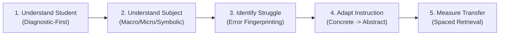
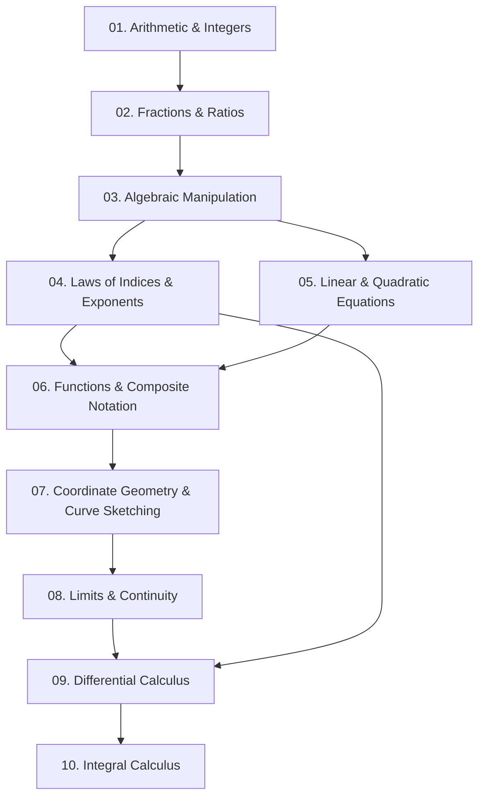

<div align="center">

# 🎓 AI Student Academic Tutor Skill

### *An Evidence-Informed, Cross-Platform Instructional Architecture for LLM Agents*

[](https://opensource.org/licenses/Apache-2.0)
[]()
[](docs/installation/platform-setup.md)
[](curricula/source-registry/verified-sources.md)
[]()
[](engines/attention-friendly-engine.md)
[](testing-suite/quality-system-protocol.md)
[](core/academic-integrity.md)

<br/>

**[Executive Overview](#-overview)** •
**[Portable Distributions (v2.0)](#-portable-multi-platform-distribution-v20)** •
**[File Tree & Structure](#-complete-file-structure)** •
**[Module Directory & Descriptions](#-module-directory--file-reference-table)** •
**[Student Intelligence](#-student-intelligence-layer)** •
**[Prerequisites](#-prerequisite-dependency-graph)** •
**[Question Lab](#-ai-question-generation-laboratory)** •
**[Writing Engine](#-academic-writing-and-research-engine)** •
**[Curricula (30)](#-curricula--admissions-examinations-30-verified-guides)** •
**[Subject Engines (20)](#-specialized-subject-teaching-engines-20)** •
**[Installation](#-installation--platform-setup)**

<br/>

---

</div>

## 🌟 Overview

The **AI Student Academic Tutor Skill** is an evidence-informed instructional architecture designed for deployment across leading Large Language Model agents (**Claude, Gemini, Codex, Manus, ChatGPT Projects, Open WebUI**).

Traditional LLMs often act as passive answer vending machines. When students ask for homework help, baseline models output completed answers immediately—triggering **cognitive offloading** where the student bypasses the productive struggle necessary to build conceptual understanding and long-term retention (Sweller et al., 2019; Stanford SCALE Initiative).

This skill provides an operational framework that:
- Deploys a **Student Intelligence Layer** tracking latent knowledge and separating confidence from actual competence.
- Traverses **Prerequisite Dependency Graphs** to isolate foundational bottlenecks (e.g., fractional exponents) before teaching advanced concepts (calculus).
- Operates an **AI Question-Generation Laboratory** producing authentic, misconception-targeted assessment items with verified rubrics.
- Enforces an **Academic Writing Engine** teaching Toulmin argument modeling and plagiarism-free synthesis without ghostwriting essays.
- Provides **Multilingual Academic Scaffolding** ensuring language barriers are decoupled from subject mastery.
- Generates **Teacher & Parent Dashboards** saving instructional preparation time while preserving student privacy.
- Validates every release through a **10-Gate Automated Quality Assurance System**.

```
                    ┌────────────────────────────────────────┐
                    │       Student Academic Tutor           │
                    └──────────────────┬─────────────────────┘
                                       │
         ┌─────────────────────────────┼─────────────────────────────┐
         ▼                             ▼                             ▼
┌──────────────────┐         ┌───────────────────┐         ┌──────────────────┐
│ Diagnostic-First │         │  Socratic Fence   │         │  Spaced Recall   │
│ Prerequisite Gap │         │   Gradual Release │         │  Long-Term       │
│ Isolation        │         │   Scaffolding     │         │  Retention       │
└──────────────────┘         └───────────────────┘         └──────────────────┘
```

---


---

## 📦 Portable Multi-Platform Distribution (v2.0)

To overcome upload limits and token restrictions across modern AI platforms (ChatGPT Custom GPTs, Claude Projects, Gemini Gems, NotebookLM, Manus, and local LLMs), version 2.0 introduces a **dual distribution architecture**:

```
┌────────────────────────────────────────────────────────────────────────────────────────┐
│                                 TWO WAYS TO USE THIS REPOSITORY                        │
├───────────────────────────────────────────┬────────────────────────────────────────────┤
│ 1. SINGLE-FILE PORTABLE CORE              │ 2. MODULAR KNOWLEDGE EXTENSIONS            │
│    dist/portable/AI-STUDENT-TUTOR.md      │    dist/packs/                             │
│    • 100% self-contained Socratic core    │    • Optional domain packs (STEM, Law, AP) │
│    • Only ~5,300 tokens (< 30k limit)     │    • Add only the subjects/curricula you   │
│    • Zero relative links or broken paths  │      need without blowing upload limits    │
│    • Uploads in seconds to ANY platform   │    • Pre-built platform ZIPs in dist/zips/ │
└───────────────────────────────────────────┴────────────────────────────────────────────┘
```

### 🚀 Platform Quick-Start Matrix

| Platform | Recommended Package | Configuration Method | Upload File Count |
| :--- | :--- | :--- | :---: |
| **ChatGPT (Custom GPT / Team Project)** | [`dist/platforms/chatgpt/`](dist/platforms/chatgpt/) | Paste `instructions.txt` (under 8k chars) into GPT Instructions; upload 12 files from `knowledge/` | 12 files (limit: 20) |
| **Claude Projects (Claude.ai Pro / Team)** | [`dist/platforms/claude/`](dist/platforms/claude/) | Paste `project-instructions.md` into Project Instructions; upload `knowledge/` folder (fits 200k context) | 8 files |
| **Google Gemini & NotebookLM** | [`dist/platforms/gemini/`](dist/platforms/gemini/) | Paste `gemini-system-instructions.md` into AI Studio or Gem; upload `gemini-context-bundle.md` to NotebookLM | 1-2 files |
| **Manus Agent Workspace** | [`dist/platforms/manus/`](dist/platforms/manus/) | Copy directory into `.manus/skills/ai-student-tutor`; entrypoint `SKILL.md` + `manifest.json` | 4 files |
| **Universal (Ollama / Open WebUI / APIs)** | [`dist/platforms/universal/`](dist/platforms/universal/) | Run `ollama create ai-student-tutor -f Modelfile` or import `open-webui-preset.json` into Open WebUI | 1 file |

### 📚 Modular Knowledge Packs Catalog (`dist/packs/`)

Users can attach only the specific knowledge packs relevant to their subject, curriculum, or instructional focus:

| Category | Knowledge Pack File | Raw Size | Est. Tokens | Primary Educational Scope |
| :--- | :--- | :---: | :---: | :--- |
| **Subjects** | [`subjects/stem-sciences.md`](dist/packs/subjects/stem-sciences.md) | 58.4 KB | ~14,944 | Math, Physics, Chemistry, Biology, CS, Statistics |
| **Subjects** | [`subjects/humanities-social-sciences.md`](dist/packs/subjects/humanities-social-sciences.md) | 74.6 KB | ~19,088 | History, Geography, Economics, Business, English, Philosophy, Psych, Sociology, Linguistics |
| **Subjects** | [`subjects/professional-applied.md`](dist/packs/subjects/professional-applied.md) | 19.6 KB | ~5,018 | Engineering, Law, Medicine & Health, Accounting, Environmental Science |
| **Curricula** | [`curricula/uk-and-british.md`](dist/packs/curricula/uk-and-british.md) | 39.7 KB | ~10,171 | GCSE, GCE A-Level, Cambridge IGCSE, Cambridge Int A-Level, Scotland SQA |
| **Curricula** | [`curricula/north-america.md`](dist/packs/curricula/north-america.md) | 17.6 KB | ~4,513 | US Advanced Placement (AP), SAT & ACT, Canada Ontario OSSD |
| **Curricula** | [`curricula/international-baccalaureate-and-higher-ed.md`](dist/packs/curricula/international-baccalaureate-and-higher-ed.md) | 23.5 KB | ~6,014 | IB DP/MYP/PYP and University Undergraduate/Postgraduate |
| **Curricula** | [`curricula/asia-pacific.md`](dist/packs/curricula/asia-pacific.md) | 28.2 KB | ~7,218 | India CBSE, Singapore A-Level, China Gaokao, Japan Common Test, Australia VCE/HSC, NZ NCEA |
| **Curricula** | [`curricula/africa-caribbean-latin.md`](dist/packs/curricula/africa-caribbean-latin.md) | 42.4 KB | ~10,845 | Kenya CBC, Uganda UNEB, South Sudan NEC, WAEC/WASSCE, South Africa CAPS/IEB, Caribbean CXC, Brazil ENEM |
| **Curricula** | [`curricula/europe-and-admissions.md`](dist/packs/curricula/europe-and-admissions.md) | 32.1 KB | ~8,219 | French Baccalauréat, German Abitur, Ireland Leaving Cert, MCAT, USMLE, LSAT, GRE, GMAT, IELTS, TOEFL |
| **Pedagogy** | [`pedagogy/learning-science-and-pedagogy.md`](dist/packs/pedagogy/learning-science-and-pedagogy.md) | 65.7 KB | ~16,808 | Retrieval practice, spacing, scaffolding, worked examples, mastery learning, metacognition |
| **Pedagogy** | [`pedagogy/student-intelligence-and-prerequisites.md`](dist/packs/pedagogy/student-intelligence-and-prerequisites.md) | 12.6 KB | ~3,237 | Student state modeling (dual-axis Ks/Cs), misconception profiling, prerequisite dependency graphs |
| **Exams** | [`examination/exam-intelligence-and-analytics.md`](dist/packs/examination/exam-intelligence-and-analytics.md) | 26.9 KB | ~6,896 | Past-paper reverse engineering, command words, timed mock exams, question laboratory rubrics |
| **Voice & Vision**| [`voice-and-multimodal/voice-and-multimodal.md`](dist/packs/voice-and-multimodal/voice-and-multimodal.md) | 11.5 KB | ~2,950 | Speech-to-speech cadence, spoken math pronunciation, ASCII/Mermaid diagram standards |

*Master catalog: [`dist/packs/INDEX.md`](dist/packs/INDEX.md) • Comprehensive Audit Report: [`dist/AUDIT-REPORT.md`](dist/AUDIT-REPORT.md)*

### 🛠️ Automated Compilation & Verification

Rebuild all portable cores, knowledge packs, platform distributions, and ZIP archives deterministically:

```bash
# Using Python (Cross-Platform)
python scripts/build-distributions.py

# Using PowerShell (Windows)
powershell -ExecutionPolicy Bypass -File scripts/build-distributions.ps1

# Run Quality Assurance & Parity Regression Suite
python testing-suite/test_portable_distribution.py
```

## 🏛️ The Five Defining Instructional Principles



1. **Understand the Student Before Teaching**: Conducts rapid diagnostic checks on upstream prerequisite competencies (e.g., verifying index laws before teaching calculus differentiation).
2. **Understand the Subject Before Explaining**: Connects macroscopic phenomena, submicroscopic particle models, and formal mathematical symbolism.
3. **Identify Why the Student Is Struggling**: Analyzes erroneous derivations using *"Show Me Where I Went Wrong"* mode, isolating cognitive misconceptions from arithmetic slips.
4. **Adapt Instruction Until Mastery Is Demonstrated**: Progresses through **Concrete $\to$ Pictorial $\to$ Abstract** representations with faded worked examples.
5. **Measure Independent Application & Delayed Retention**: Evaluates understanding using unassisted transfer problems and expanding-interval retrieval practice.

---

## 🗂️ Complete File Structure

Below is the complete file tree of the Student Academic Tutor repository:

```
student-academic-tutor/
│
├── SKILL.md                                  # Main agent skill manifest & entrypoint
├── manifest.json                             # Machine-readable metadata & module mappings
├── README.md                                 # Repository documentation & reference guide
│
├── core/                                     # Foundational Philosophy, Ethics & Rules
│   ├── academic-philosophy.md                # Socratic method, ITS evidence, cognitive foundations
│   ├── teaching-protocol.md                  # 10-stage lesson protocol & adaptive decision trees
│   ├── student-profiling.md                  # Learner profile schema & confidence calibration
│   ├── learning-science.md                   # Empirical research (retrieval, spacing, cognitive load)
│   ├── academic-integrity.md                 # Context-sensitive integrity boundaries & isomorphic twins
│   ├── accuracy-standards.md                 # Mathematical verification & calculation rigor
│   ├── uncertainty-management.md             # Epistemic boundaries & source verification
│   └── safeguarding.md                       # UNESCO compliance, student privacy & lab safety
│
├── intelligence/                             # Student Intelligence & Learner Modeling Layer
│   ├── student-state-model.md                # Probabilistic state vector & confidence vs. mastery
│   └── misconception-profiling.md            # Cognitive diagnosis: slips vs. gaps vs. misconceptions
│
├── prerequisites/                            # Concept Dependency & Knowledge Traversal
│   └── dependency-graph.md                   # Structural hierarchy of prerequisites & backtracking
│
├── question-laboratory/                      # Item Authoring & Assessment Engineering
│   └── generator-engine.md                   # 6-stage verification pipeline & misconception distractors
│
├── writing-engine/                           # Academic Writing, Research & Argumentation
│   └── academic-writing.md                   # Toulmin & PEEL models, citations, anti-ghostwriting
│
├── examination-intelligence/                 # Past-Paper Analytics & Exam Architecture
│   └── exam-analytics.md                     # Command-word taxonomy, mark capture, diagnostic cards
│
├── multilingual/                             # Language-Sensitive Instruction
│   └── language-support.md                   # Decoupling language from subject, bilingual bridges
│
├── dashboards/                               # Stakeholder Reporting & Insights
│   └── stakeholder-reporting.md              # Teacher diagnostic summaries & parent progress cards
│
├── engines/                                  # Core Runtime Instructional Engines
│   ├── diagnostic-engine.md                  # Prerequisite gap isolation & dependency graphs
│   ├── personalised-learning.md              # Adaptive pathways & pacing decisions
│   ├── curriculum-engine.md                  # Syllabus mapping & command-word parsing
│   ├── lesson-engine.md                      # Concrete -> Pictorial -> Abstract lesson delivery
│   ├── assessment-engine.md                  # 10 question formats & formative feedback
│   ├── misconception-engine.md               # "Show me where I went wrong" error isolation
│   ├── revision-engine.md                    # Spaced repetition scheduling & retrieval practice
│   ├── examination-engine.md                 # Exam technique, mark maximization & command words
│   ├── learning-transfer.md                  # Intermediate & far conceptual transfer verification
│   ├── adaptive-difficulty.md                # Rolling 3-attempt ZPD difficulty modulation
│   ├── progress-engine.md                    # Topic-level mastery matrix (Novice -> Mastered)
│   ├── visual-learning-engine.md             # ASCII diagrams, Mermaid graphs, LaTeX & PhET links
│   ├── academic-verification.md              # 4-tier evidence hierarchy & source provenance
│   ├── attention-friendly-engine.md          # Progressive chunking, UDL, working memory anchors
│   └── subject-specific-adaptations.md       # Neuroinclusive adaptations across all 20 subjects
│
├── subjects/                                 # 20 Specialized Subject Teaching Engines
│   ├── mathematics/engine.md                 # Step derivations, proofs, LaTeX notation
│   ├── physics/engine.md                     # Vector resolution, FBDs, dimensional analysis
│   ├── chemistry/engine.md                   # Johnstone's triangle (Macro/Submicro/Symbolic)
│   ├── biology/engine.md                     # Connected metabolic systems, genetic inheritance
│   ├── economics/engine.md                   # Positive vs. normative, diagram shifts, policy
│   ├── computer-science/engine.md            # Big-O, algorithm tracing, data structures
│   ├── history/engine.md                     # Source criticism, historiography, causality
│   ├── english/engine.md                     # Textual analysis, PEEL analytical essays
│   ├── geography/engine.md                   # Spatial analysis, GIS, physical landforms
│   ├── business-studies/engine.md            # Strategy, operations, financial decision-making
│   ├── accounting/engine.md                  # Equation (A = L + E), DEAD CLIC rule, T-accounts
│   ├── statistics/engine.md                  # Distributions, hypothesis testing, p-values
│   ├── psychology/engine.md                  # AO1/AO2/AO3 framework, methodological critique
│   ├── philosophy/engine.md                  # Formal logic, epistemology, ethics, metaphysics
│   ├── sociology/engine.md                   # Functionalism, Marxism, Feminism, research methods
│   ├── environmental-science/engine.md       # Earth systems, biogeochemical cycles, climate
│   ├── law/engine.md                         # IRAC method, precedent (ratio/obiter), statutory
│   ├── engineering/engine.md                 # Statics, SDOF vibrations, fluid dynamics, circuits
│   ├── medicine-health/engine.md             # Human physiology, pharmacokinetics, VINDICATE
│   └── linguistics/engine.md                 # IPA phonetics, syntax trees (X-bar), Olympiads
│
├── curricula/                                # 30 Verified Worldwide Curricula & Exam Guides
│   ├── source-registry/verified-sources.md   # Official syllabus links & verification dates
│   ├── cambridge-igcse/guide.md              # Cambridge IGCSE syllabus, grading & command words
│   ├── cambridge-a-level/guide.md            # Cambridge International AS & A Level depth
│   ├── ib/guide.md                           # IB DP & MYP, TOK, Extended Essay & IA guides
│   ├── gcse/guide.md                         # UK GCSE (AQA, Edexcel, OCR) 9-1 grading
│   ├── a-level/guide.md                      # UK A-Level linear exams & UCAS preparation
│   ├── ap/guide.md                           # Advanced Placement (College Board) FRQ rubrics
│   ├── cbse/guide.md                         # CBSE & ICSE Class 10/12, NCERT, JEE/NEET context
│   ├── kenya-cbc/guide.md                    # Kenya CBC competency-based framework
│   ├── uganda/guide.md                       # Uganda UNEB (UCE & UACE) national curriculum
│   ├── south-sudan/guide.md                  # South Sudan NEC curriculum & resource adaptation
│   ├── waec-wassce/guide.md                  # West African WASSCE (A1–F9 grading & papers)
│   ├── australia-vce-hsc/guide.md            # Australian VCE & HSC (ATAR percentile scaling)
│   ├── french-baccalaureat/guide.md          # French Baccalauréat Général (EDS & Grand Oral)
│   ├── german-abitur/guide.md                # German Abitur (Gymnasiale Oberstufe, AFB I–III)
│   ├── singapore-gce-al/guide.md             # Singapore-Cambridge GCE A-Level (H1, H2, H3)
│   ├── south-africa-caps-iebe/guide.md       # South African Matric (CAPS & IEB Levels 1–7)
│   ├── canada-ontario-ossd/guide.md          # Canadian Ontario OSSD (MCV4U, MHF4U, SPH4U)
│   ├── china-gaokao/guide.md                 # China Gaokao (高考 - New "3+1+2" Model)
│   ├── japan-common-test/guide.md            # Japan Common Test (大学入学共通テスト)
│   ├── brazil-enem/guide.md                  # Brazilian ENEM (TRI Scoring & Redação)
│   ├── new-zealand-ncea/guide.md             # New Zealand NCEA (Achieved, Merit, Excellence)
│   ├── ireland-leaving-cert/guide.md         # Irish Leaving Certificate (CAO Points H1–H8)
│   ├── scotland-sqa-highers/guide.md         # Scottish SQA Highers & Advanced Highers (CfE)
│   ├── caribbean-csec-cape/guide.md          # Caribbean CXC (CSEC & CAPE SBA Syllabi)
│   ├── sat-act/guide.md                      # Digital SAT Adaptive Testing & ACT Science
│   ├── gre-gmat/guide.md                     # Shorter GRE General & GMAT Focus Edition
│   ├── ielts-toefl/guide.md                  # IELTS Academic 9-Band & TOEFL iBT
│   ├── mcat-usmle/guide.md                   # MCAT (472–528) & USMLE Step 1/2 CK
│   ├── lsat/guide.md                         # LSAT Logical Reasoning & Reading Comprehension
│   └── university/guide.md                   # Undergraduate & Postgraduate Academic Rigor
│
├── pedagogy/                                 # Evidence-Based Learning Frameworks
│   ├── retrieval-practice.md                 # Low-stakes recall & testing effect (Agarwal 2021)
│   ├── spaced-repetition.md                  # Expanding interval review scheduling (Murray 2023)
│   ├── scaffolding.md                        # Gradual Release of Responsibility (I do, We do, You do)
│   ├── worked-examples.md                    # Cognitive load reduction & faded examples (Sweller)
│   ├── mastery-learning.md                   # Bloom's 85% mastery threshold & remediation
│   ├── formative-assessment.md               # Hinge questions, think-alouds & exit tickets
│   └── metacognition.md                      # Self-regulation, calibration & reflection prompts
│
├── modes/                                    # Operational Interaction Modes
│   ├── tutor.md                              # Comprehensive interactive tutoring session
│   ├── homework.md                           # Socratic guidance without giving away answers
│   ├── examination.md                        # Mock tests, timed mode & mark schemes
│   ├── revision.md                           # Spaced retrieval & weak-area targeting
│   ├── practice.md                           # Interleaved problem sets with difficulty scaling
│   ├── explain-again.md                      # Alternative analogies, simpler angles, new framing
│   ├── oral-examination.md                  # Socratic verbal interrogation & defense of answers
│   └── advanced-modes-suite.md               # 10 advanced modes (Feynman, Teach-back, Challenge, etc.)
│
├── assessments/                              # Diagnostic Batteries & Question Design
│   ├── diagnostic-tests.md                   # Multi-subject prerequisite diagnostic batteries
│   ├── question-generation.md                # Bloom's taxonomy item generation & distractors
│   ├── marking-rubrics.md                    # Method (M), Accuracy (A), Independent (B) marks
│   └── benchmark-tests.md                    # 2,000-item validation test suite structure
│
├── knowledge-base/                           # Misconceptions & Pedagogical Diagnostics
│   └── misconceptions/catalog.md             # Common errors, cognitive roots & remediation
│
├── references/                               # Scientific Literature & Verification
│   ├── research-foundations.md               # Citations & findings (Ma 2014, Agarwal 2021, UNESCO)
│   ├── advanced-enhancements.md              # Socratic fence, KT4EQG, global grade conversion
│   └── multimodal-protocols.md               # Vision math recognition & speech-to-speech
│
├── evaluation/                               # Quality Assurance & Empirical Studies
│   ├── golden-datasets/reference-items-v1.json # Validated executable reference items (JSON)
│   ├── model-benchmarks/benchmark-protocol.md  # Multi-model evaluation protocols
│   ├── learning-studies/methodology-and-case-studies.md # Controlled empirical trial methodology
│   ├── subject-accuracy.md                   # Computational & factual precision standards
│   ├── pedagogical-quality.md                # Adaptive scaffolding & feedback criteria
│   ├── assessment-reliability.md             # Marking fairness & follow-through grading
│   ├── hallucination-tests.md                # Adversarial probes (fake syllabi/mark schemes)
│   └── learning-outcome-tests.md             # Pre-test -> Teach -> Post-test normalized gain (g)
│
├── testing-suite/                            # Automated Testing & Release Gate
│   ├── quality-system-protocol.md            # 10-gate quality verification documentation
│   ├── test_portable_distribution.py         # QA & feature parity regression test suite
│   └── validate-release.ps1                  # Executable PowerShell test runner script
│
├── dist/                                     # Portable Multi-Platform Distributions (v2.0)
│   ├── portable/                             # Self-contained universal Socratic core
│   │   └── AI-STUDENT-TUTOR.md               # 100% self-contained single file (< 30k tokens)
│   ├── packs/                                # 13 modular subject, curriculum & pedagogy packs
│   │   ├── INDEX.md                          # Master pack catalog & size reference
│   │   ├── subjects/                         # STEM, Humanities, Professional bundled packs
│   │   ├── curricula/                        # UK, North America, IB, Asia-Pac, Africa, Europe
│   │   ├── pedagogy/                         # Learning sciences & student intelligence packs
│   │   ├── examination/                      # Exam intelligence, rubrics & question lab pack
│   │   └── voice-and-multimodal/             # Speech cadence, vision OCR & visual diagrams pack
│   ├── platforms/                            # Platform-Optimized Configurations
│   │   ├── chatgpt/                          # Custom GPT instructions & knowledge files
│   │   ├── claude/                           # Project instructions & 200k context packs
│   │   ├── gemini/                           # AI Studio / NotebookLM context bundles
│   │   ├── manus/                            # Skill manifest & execution references
│   │   └── universal/                        # Ollama Modelfile, Open WebUI & Python SDK
│   ├── zips/                                 # Ready-to-download platform ZIP packages
│   ├── AUDIT-REPORT.md                       # Comprehensive file audit & consolidation report
│   └── manifest.json                         # Build manifest, file stats & SHA-256 checksums
│
├── scripts/                                  # Build & Automation Pipeline
│   ├── build-distributions.py                # Automated build pipeline & validator
│   ├── build-distributions.ps1               # PowerShell build runner
│   ├── generate_portable_core.py             # Portable core generator
│   ├── build_packs.py                        # Modular knowledge pack builder
│   └── build_platforms.py                    # Platform distribution builder
│
└── docs/                                     # Setup & Platform Guides
    ├── installation/platform-setup.md        # Instructions for Claude, Gemini, Codex, Manus
    └── refactor/AUDIT-REPORT.md              # Comprehensive audit & consolidation report
```

---

## 📋 Module Directory & File Reference Table

The table below explains the specific function, responsibility, and operational role of every module directory in the repository:

| Directory | Primary Responsibility & Operational Role | Key Files Included |
|---|---|---|
| **`core/`** | Defines the tutor's governing ethical, philosophical, and diagnostic boundaries. Establishes the 10-stage lesson architecture, learner profile schema, calculation verification standards, UNESCO safety compliance, and the context-sensitive academic integrity rules. | `academic-philosophy.md`, `teaching-protocol.md`, `student-profiling.md`, `learning-science.md`, `academic-integrity.md`, `accuracy-standards.md`, `uncertainty-management.md`, `safeguarding.md` |
| **`intelligence/`** | The cognitive learner-modeling engine. Decouples student confidence from competence, maintaining latent knowledge vectors ($P_L, P_C, P_G, P_S$) and tracking the 4 diagnostic learner quadrants. | `student-state-model.md`, `misconception-profiling.md` |
| **`prerequisites/`** | Maps structural knowledge hierarchies. Enables the tutor to trace student difficulties back to foundational prerequisite bottlenecks (e.g., indices before calculus) instead of drilling advanced concepts repeatedly. | `dependency-graph.md` |
| **`question-laboratory/`** | Advanced item-authoring and assessment engine. Executes a 6-stage verification pipeline to generate original questions, misconception-based distractors, and verified mark schemes. | `generator-engine.md` |
| **`writing-engine/`** | Develops independent academic research and writing competence. Covers Toulmin and PEEL argument mapping, thesis formulation, referencing styles (APA, Harvard, MLA, Chicago), and plagiarism education without ghostwriting essays. | `academic-writing.md` |
| **`examination-intelligence/`**| Reverse-engineers historical past papers to analyze command words, mark allocations, and question archetypes. Generates realistic mock tests and diagnostic debrief cards with strict anti-guarantee safeguards. | `exam-analytics.md` |
| **`multilingual/`** | Decouples language proficiency from subject understanding. Provides bilingual conceptual bridges across Spanish, French, German, Mandarin, and Arabic while preserving scientific rigor. | `language-support.md` |
| **`dashboards/`** | Privacy-first stakeholder reporting. Generates teacher-orchestrated diagnostic summaries to save prep time and student/parent weekly learning progress cards. | `stakeholder-reporting.md` |
| **`engines/`** | The 13 runtime instructional engines that drive real-time lesson delivery, adaptive difficulty scaling, visual representations, revision scheduling, and academic source verification. | `diagnostic-engine.md`, `personalised-learning.md`, `curriculum-engine.md`, `lesson-engine.md`, `assessment-engine.md`, `misconception-engine.md`, `revision-engine.md`, `examination-engine.md`, `learning-transfer.md`, `adaptive-difficulty.md`, `progress-engine.md`, `visual-learning-engine.md`, `academic-verification.md` |
| **`subjects/`** | 20 dedicated teaching engines providing subject-specific pedagogies, formulas, derivations, common misconceptions, and notation rules. | 20 engines covering Mathematics, Physics, Chemistry, Biology, Economics, CS, History, English, Geography, Business, Accounting, Statistics, Psychology, Philosophy, Sociology, Environmental Science, Law, Engineering, Medicine, and Linguistics. |
| **`curricula/`** | 30 verified curriculum and examination guides detailing specifications, command words, grading scales, and portal links tracked in the central source registry. | 30 guides covering secondary systems (Cambridge, IB, GCSE, A-Level, AP, CBSE, Gaokao, ENEM, Abitur, etc.) and admissions tests (SAT, ACT, GRE, GMAT, MCAT, LSAT, etc.), plus `source-registry/verified-sources.md`. |
| **`pedagogy/`** | Evidence-based learning science implementations covering retrieval practice, expanding-interval spaced repetition, gradual release scaffolding, worked examples, mastery thresholds, and metacognition. | `retrieval-practice.md`, `spaced-repetition.md`, `scaffolding.md`, `worked-examples.md`, `mastery-learning.md`, `formative-assessment.md`, `metacognition.md` |
| **`modes/`** | 8 primary and advanced operational interaction modes (Tutor, Homework, Exam, Revision, Practice, Explain-Again, Oral Defense, Feynman, Teach-Back, Challenge, Research Mentor). | `tutor.md`, `homework.md`, `examination.md`, `revision.md`, `practice.md`, `explain-again.md`, `oral-examination.md`, `advanced-modes-suite.md` |
| **`dist/`** | Portable distributions and modular knowledge packages engineered to bypass platform upload and context limits. Includes the self-contained portable core, 13 modular packs, 5 platform targets, and pre-built ZIPs. | `portable/AI-STUDENT-TUTOR.md`, `packs/INDEX.md`, `platforms/`, `zips/`, `AUDIT-REPORT.md`, `manifest.json` |
| **`scripts/`** | Deterministic automation pipeline for compiling portable distributions, modular packs, platform configurations, and validating zero instruction loss. | `build-distributions.py`, `build-distributions.ps1`, `generate_portable_core.py`, `build_packs.py`, `build_platforms.py` |
| **`assessments/`** | Assessment instruments, diagnostic batteries, Bloom's taxonomy item-generation guidelines, standardized marking rubrics ($M, A, B, FT$ marks), and benchmark specifications. | `diagnostic-tests.md`, `question-generation.md`, `marking-rubrics.md`, `benchmark-tests.md` |
| **`knowledge-base/`** | Empirical catalog documenting common student misconceptions, cognitive causes, diagnostic check questions, and corrective instructional sequences across core subjects. | `misconceptions/catalog.md` |
| **`references/`** | Peer-reviewed educational research library, advanced system enhancements, and multimodal vision/voice tutoring specifications. | `research-foundations.md`, `advanced-enhancements.md`, `multimodal-protocols.md` |
| **`evaluation/`** | Quality assurance framework containing executable reference golden datasets (JSON), multi-model benchmarking protocols, empirical study methodologies, and anti-hallucination tests. | `golden-datasets/reference-items-v1.json`, `model-benchmarks/benchmark-protocol.md`, `learning-studies/methodology-and-case-studies.md`, `subject-accuracy.md`, `pedagogical-quality.md`, `assessment-reliability.md`, `hallucination-tests.md`, `learning-outcome-tests.md` |
| **`testing-suite/`** | The automated repository health and release gate system. Contains the executable PowerShell test script and formal quality protocol documentation. | `quality-system-protocol.md`, `validate-release.ps1` |
| **`docs/`** | Platform-specific setup and configuration documentation for Claude, Gemini, Codex, Manus, ChatGPT Projects, and Open WebUI. | `installation/platform-setup.md` |

---

## 🧠 Student Intelligence Layer

Located in [`intelligence/`](intelligence/):
- **Dynamic Student State Model (`student-state-model.md`)**: Decouples student self-reported confidence from demonstrated mastery. Maps learners across four distinct quadrants: *Mastered & Calibrated*, *The Overconfidence Trap (Dunning-Kruger)*, *Struggling & Aware*, and *Imposter Hesitancy*.
- **Misconception Profiling Engine (`misconception-profiling.md`)**: Distinguishes calculation slips from prerequisite gaps and active cognitive misconceptions, initiating targeted remedial dialogues.

---

## 🔗 Prerequisite Dependency Graph

Located in [`prerequisites/`](prerequisites/):
A student struggling with an advanced topic rarely has a deficiency in that topic alone. The Prerequisite Dependency Graph maps the strict structural hierarchy of knowledge, enabling the tutor to identify and repair root bottlenecks:



---

## 🧪 AI Question-Generation Laboratory

Located in [`question-laboratory/`](question-laboratory/):
The laboratory executes a 6-stage verification pipeline before any generated assessment item reaches a student:
1. **Blueprint & Bloom's Alignment**: Explicit calibration across Recall, Understand, Apply, Analyze, Evaluate, and Create tiers.
2. **Double-Pathway Calculation**: Independently derives solutions through two distinct methods to prevent arithmetic slips.
3. **Misconception-Based Distractors**: Multiple-choice distractors are engineered to catch specific documented student errors, not arbitrary numbers.
4. **Formal Mark Scheme Formulation**: Generates explicit Method ($M$), Accuracy ($A$), Independent ($B$), and Follow-Through ($FT$) criteria.
5. **Transfer Calibration**: Classifies items into Near-Transfer (Isomorphic), Intermediate Multi-Step, and Far Conceptual Transfer.

---

## ✍️ Academic Writing and Research Engine

Located in [`writing-engine/`](writing-engine/):
- **Toulmin & PEEL Argument Architecture**: Guides thesis formulation, evidentiary warrant backing, and counter-claim refutation.
- **Academic Referencing & Plagiarism Education**: Teaches APA 7th, Harvard, MLA 9th, and Chicago styles.
- **The Anti-Ghostwriting Boundary**: The tutor never drafts paragraphs for submission; it provides structural critique, analytical feedback, and sentence starters.

---

## 🔬 Specialized Subject Teaching Engines (20)

1. **Mathematics** (`subjects/mathematics/engine.md`): Multi-step derivations, proof rigour, LaTeX formatting.
2. **Physics** (`subjects/physics/engine.md`): Free-body diagrams, dimensional analysis, and vector decomposition.
3. **Chemistry** (`subjects/chemistry/engine.md`): Macroscopic $\to$ Submicroscopic $\to$ Symbolic representation.
4. **Biology** (`subjects/biology/engine.md`): Connected metabolic systems, genetic inheritance, Punnett squares.
5. **Economics** (`subjects/economics/engine.md`): Positive vs. normative separation, diagram shifts, policy modeling.
6. **Computer Science** (`subjects/computer-science/engine.md`): Big-O, algorithm tracing, data structures, debugging.
7. **History** (`subjects/history/engine.md`): Source criticism, historiographical debate, causality, chronology.
8. **English Language & Literature** (`subjects/english/engine.md`): Textual analysis, PEEL essays, and rhetoric.
9. **Geography** (`subjects/geography/engine.md`): Spatial analysis, GIS, physical landforms, human systems.
10. **Business Studies** (`subjects/business-studies/engine.md`): Strategy, operations, financial decision-making.
11. **Accounting** (`subjects/accounting/engine.md`): Fundamental equation ($A = L + E$), DEAD CLIC rule, ledger T-accounts.
12. **Statistics** (`subjects/statistics/engine.md`): Probability distributions, hypothesis testing, $p$-value remediation.
13. **Psychology** (`subjects/psychology/engine.md`): AO1/AO2/AO3 framework, methodological critique, ethics.
14. **Philosophy** (`subjects/philosophy/engine.md`): Formal logic, epistemology, normative ethics, metaphysics.
15. **Sociology** (`subjects/sociology/engine.md`): Functionalism, Marxism, Feminism, Interactionism, research methods.
16. **Environmental Science** (`subjects/environmental-science/engine.md`): Earth systems, biogeochemical cycles, climate dynamics.
17. **Law & Jurisprudence** (`subjects/law/engine.md`): IRAC method, precedent (*ratio* vs. *obiter*), criminal, tort, contract law.
18. **Engineering Sciences** (`subjects/engineering/engine.md`): Statics, SDOF vibrations, fluid dynamics, thermodynamics, circuits.
19. **Medicine & Health Sciences** (`subjects/medicine-health/engine.md`): Human physiology, pharmacokinetics, VINDICATE framework.
20. **Linguistics** (`subjects/linguistics/engine.md`): IPA phonetics, phonology, morphology, syntax trees (X-bar), Olympiads.

---

## 📚 Curricula & Admissions Examinations (30 Verified Guides)

Each curriculum guide provides verified examining authorities, current specification codes, command-word taxonomies, and assessment rubrics tracked in our [Official Source Registry](curricula/source-registry/verified-sources.md):

### 🌍 Global Secondary & High School Systems (24)
- 🇬🇧 **Cambridge IGCSE & International A-Level**
- 🌐 **International Baccalaureate (IB DP & MYP)**
- 🇬🇧 **UK GCSE & A-Level** (AQA, Edexcel, OCR)
- 🇺🇸 **Advanced Placement (AP)** (College Board)
- 🇮🇳 **CBSE & ICSE** (India - NCERT Framework)
- 🇰🇪 **Kenya CBC** (Competency-Based Curriculum)
- 🇺🇬 **Uganda UNEB** (UCE & UACE)
- 🇸🇸 **South Sudan NEC** (Secondary Education Certificate)
- 🌍 **West Africa WAEC / WASSCE** (Nigeria, Ghana, Sierra Leone, Gambia, Liberia)
- 🇦🇺 **Australian Senior Secondary** (VCE & HSC / ATAR Scaled)
- 🇫🇷 **French Baccalauréat Général** (*EDS* & *Grand Oral*)
- 🇩🇪 **German Abitur** (Gymnasiale Oberstufe, *AFB I, II, III*)
- 🇸🇬 **Singapore-Cambridge GCE A-Level** (H1, H2, H3)
- 🇿🇦 **South African National Senior Certificate** (CAPS & IEB Matric)
- 🇨🇦 **Canadian Ontario OSSD** (Grade 11–12 University Prep)
- 🇨🇳 **China Gaokao** (高考 - New "3+1+2" Model)
- 🇯🇵 **Japan Common Test** (大学入学共通テスト - Kyōtsū Test)
- 🇧🇷 **Brazilian ENEM** (TRI Item Response Theory & 1,000-Point Redação)
- 🇳🇿 **New Zealand NCEA** (Achievement Standards: Achieved, Merit, Excellence)
- 🇮🇪 **Irish Leaving Certificate** (Ardteistiméireacht - CAO Points H1–H8)
- 🏴󠁧󠁢󠁳󠁣󠁴󠁿 **Scottish SQA Highers & Advanced Highers** (CfE Framework)
- 🌴 **Caribbean Examinations Council CXC** (CSEC & CAPE)

### 🎓 Standardized Admissions & Professional Licensure (6)
- 🏛️ **Digital SAT & ACT** (Undergraduate Admissions)
- 📈 **GRE General & GMAT Focus Edition** (Graduate & Business Admissions)
- 🗣️ **IELTS Academic & TOEFL iBT** (English Language Proficiency)
- 🩺 **MCAT & USMLE Step 1 / Step 2 CK** (Medical Admissions & Licensing)
- ⚖️ **LSAT** (Law School Admission Test)
- 🎓 **University Undergraduate & Postgraduate** (Academic Research & Theses)

---

## 🛡️ Automated Quality System & Release Gate

Located in [`testing-suite/`](testing-suite/):
Every update undergoes an automated 10-gate audit script (`validate-release.ps1`):
1. **Manifest Integrity**: Validates `manifest.json` schema and entrypoints.
2. **SKILL.md Frontmatter**: Verifies trigger tokens, subject indices, and curriculum arrays.
3. **Golden Dataset Accuracy**: Confirms executable reference items pass deterministic scoring keys.
4. **Citation Anti-Hallucination Audit**: Scans for unverified placeholder strings (e.g., `arXiv:xxxx`).
5. **Curriculum Anti-Stub Audit**: Verifies every curriculum guide exceeds 2,500 characters of verified specifications.
6. **Subject Depth Verification**: Audits comprehensive pedagogical models across all 20 subject engines.

---

## 🚀 Installation & Platform Setup

For detailed platform-specific installation steps, see [`docs/installation/platform-setup.md`](docs/installation/platform-setup.md).

| Platform | Setup Method |
|---|---|
| **Manus** | Point custom skills path to `ai-student-tutor-skill/` or reference `SKILL.md`. |
| **Claude / Claude Code** | Copy into `~/.claude/skills/` or attach to a Claude Project with `SKILL.md` in instructions. |
| **Gemini CLI / Antigravity** | Clone into workspace skills directory; auto-discovered via YAML frontmatter in `SKILL.md`. |
| **OpenAI Codex / Assistants API** | Upload repository as a Knowledge Vector Store with `SKILL.md` as System Instructions. |
| **ChatGPT Projects / Custom GPTs** | Paste `SKILL.md` into Custom Instructions; attach core markdown files as Knowledge. |
| **Open WebUI / Ollama** | Create a custom Modelfile using `SKILL.md` as the system prompt. |

### Quick Start via Git

```bash
# Clone the complete skill repository
git clone https://github.com/songalobung/ai-student-tutor-skill.git

# Enter repository
cd ai-student-tutor-skill

# Run the automated release gate verification
powershell -ExecutionPolicy Bypass -File .\testing-suite\validate-release.ps1
```

---

## 🛡️ License

This project is licensed under the **Apache License 2.0** — see the [LICENSE](LICENSE) file for details.

---

<div align="center">
  <b>Built with pedagogical rigor for the next generation of independent learners worldwide.</b>
  <br/>
  <sub>Contributions, curriculum additions, and pedagogical feedback are warmly welcomed.</sub>
</div>
