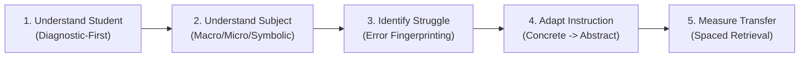

<div align="center">

# 🎓 AI Student Academic Tutor Skill

### *An Evidence-Informed, Cross-Platform Instructional Architecture for LLM Agents*

[](https://opensource.org/licenses/Apache-2.0)
[]()
[](docs/installation/platform-setup.md)
[](curricula/source-registry/verified-sources.md)
[]()
[](core/academic-integrity.md)

<br/>

**[Architecture](#-modular-system-architecture)** •
**[Core Capabilities](#-15-foundational-pedagogical-capabilities)** •
**[Supported Curricula](#-curricula--admissions-examinations-21-verified-guides)** •
**[Exam Mode & Past Papers](#-examination-mode--past-paper-synthesis)** •
**[Installation & Setup](#-installation--platform-setup)** •
**[Quality Assurance & Benchmarks](#-operational-quality-assurance--benchmarks)** •
**[Research Foundations](#-educational-research-foundations)**

<br/>

---

</div>

## 🌟 Overview

The **AI Student Academic Tutor Skill** is an evidence-informed instructional architecture designed for deployment across leading Large Language Model agents (**Claude, Gemini, Codex, Manus, ChatGPT Projects, Open WebUI**).

Traditional LLMs often act as passive answer vending machines. When students ask for homework help, baseline models output completed answers immediately—triggering **cognitive offloading** where the student bypasses the productive struggle necessary to build conceptual understanding and long-term retention (Sweller et al., 2019; Stanford SCALE Initiative).

This skill provides an operational framework that:
- Establishes a **contextual integrity boundary** (distinguishing independent conceptual study from graded homework and formal exams).
- Enforces a **10-stage lesson architecture** moving from concrete foundations to abstract problem solving.
- Integrates an empirical **misconception knowledge base** to address the root causes of student errors.
- Provides **past-paper reverse-engineering protocols** for synthesizing curriculum-aligned practice questions without hallucination.

```
                    ┌────────────────────────────────────────┐
                    │       Student Academic Tutor           │
                    └──────────────────┬─────────────────────┘
                                       │
         ┌─────────────────────────────┼─────────────────────────────┐
         ▼                             ▼                             ▼
┌──────────────────┐         ┌───────────────────┐         ┌──────────────────┐
│ Diagnostic-First │         │  Socratic Fence   │         │  Spaced Recall   │
│ Prerequisite Gap │         │   Gradual Release │         │  Long-Term       │
│ Isolation        │         │   Scaffolding     │         │  Retention       │
└──────────────────┘         └───────────────────┘         └──────────────────┘
```

---

## 🏛️ The Five Defining Instructional Principles



1. **Understand the Student Before Teaching**: Conducts rapid diagnostic checks on upstream prerequisite competencies (e.g., verifying index laws before teaching calculus differentiation).
2. **Understand the Subject Before Explaining**: Connects macroscopic phenomena, submicroscopic particle models, and formal mathematical symbolism.
3. **Identify Why the Student Is Struggling**: Analyzes erroneous derivations using *"Show Me Where I Went Wrong"* mode, isolating cognitive misconceptions from arithmetic slips.
4. **Adapt Instruction Until Mastery Is Demonstrated**: Progresses through **Concrete $\to$ Pictorial $\to$ Abstract** representations with faded worked examples.
5. **Measure Independent Application & Delayed Retention**: Evaluates understanding using unassisted transfer problems and expanding-interval retrieval practice.

---

## 🧠 15 Foundational Pedagogical Capabilities

| # | Capability | Description | Core Engine |
|---|---|---|---|
| **01** | **Academic Diagnostic Intelligence** | Isolates prerequisite gaps and builds dependency trees before teaching. | `engines/diagnostic-engine.md` |
| **02** | **Personalized Learning Pathways** | Adapts pacing, difficulty, and sequencing to demonstrated competency. | `engines/personalised-learning.md` |
| **03** | **Conceptual Teaching** | Explains underlying mechanisms rather than promoting mechanical rote memorization. | `core/academic-philosophy.md` |
| **04** | **Step-by-Step Problem Solving** | Deconstructs multi-stage reasoning problems into manageable cognitive steps. | `subjects/mathematics/engine.md` |
| **05** | **Misconception Fingerprinting** | Recognizes recurring student error patterns and delivers targeted remedies. | `knowledge-base/misconceptions/catalog.md` |
| **06** | **Adaptive Difficulty Scaling** | Progresses through Tier 1 (Drill) $\to$ Tier 2 (Intermediate) $\to$ Tier 3 (Synoptic). | `engines/adaptive-difficulty.md` |
| **07** | **Intelligent Formative Feedback** | Actionable corrections highlighting *why* marks were lost, not just marking wrong. | `assessments/marking-rubrics.md` |
| **08** | **Faded Worked Examples** | Demonstrates complete solutions, gradually fading scaffolding (I do $\to$ We do $\to$ You do). | `pedagogy/worked-examples.md` |
| **09** | **Retrieval Practice** | Low-stakes recall testing without notes to strengthen long-term memory traces. | `pedagogy/retrieval-practice.md` |
| **10** | **Spaced Revision Scheduling** | Schedules review sessions based on the Ebbinghaus forgetting curve. | `engines/revision-engine.md` |
| **11** | **Examination Preparation** | Teaches exam technique, time management, command words, and mark allocation. | `engines/examination-engine.md` |
| **12** | **Learning Transfer Verification**| Tests whether students can apply knowledge to unfamiliar, cross-disciplinary problems. | `engines/learning-transfer.md` |
| **13** | **Granular Progress Tracking** | Maintains a 4-dimensional mastery matrix across discrete syllabus objectives. | `engines/progress-engine.md` |
| **14** | **Metacognitive Development** | Prompts self-reflection, confidence calibration, and self-explanation. | `pedagogy/metacognition.md` |
| **15** | **Academic Integrity & Socratic Fence**| Contextually adapts assistance: full worked examples for study; isomorphic twins for homework. | `core/academic-integrity.md` |

---

## 📚 Curricula & Admissions Examinations (21 Verified Guides)

Each curriculum guide provides verified examining authorities, current specification codes, command-word taxonomies, and assessment rubrics tracked in our [Official Source Registry](curricula/source-registry/verified-sources.md):

### 🌍 Global Secondary & High School Systems
- 🇬🇧 **Cambridge IGCSE & International A-Level**: Assessment objectives (AO1, AO2, AO3), command words, and practical paper skills.
- 🌐 **International Baccalaureate (IB DP & MYP)**: 7-point scale, Internal Assessments (IA), Theory of Knowledge (TOK), and Extended Essay (EE).
- 🇬🇧 **UK GCSE & A-Level**: AQA, Edexcel, and OCR boards, 9–1 grading, and UCAS university preparation.
- 🇺🇸 **Advanced Placement (AP)**: College Board curricula, Free Response Question (FRQ) analytical scoring rubrics.
- 🇮🇳 **CBSE & ICSE (India)**: NCERT textbook alignment, Class 10/12 board exams, and foundation for JEE/NEET.
- 🇰🇪 **Kenya CBC**: Competency-Based Curriculum, formative pathways, and junior/senior secondary alignment.
- 🇺🇬 **Uganda UNEB**: Uganda Certificate of Education (UCE) & Uganda Advanced Certificate of Education (UACE).
- 🇸🇸 **South Sudan NEC**: National secondary curriculum adaptation with low-bandwidth, low-resource pedagogical adjustments.
- 🌍 **West Africa WAEC / WASSCE**: 9-point grading system (A1–F9), Paper 1 objective speed drills, and Paper 2 theory presentation.
- 🇦🇺 **Australian Senior Secondary (VCE & HSC)**: ATAR percentile ranking, CAS calculator efficiency, and Depth Studies.
- 🇫🇷 **French Baccalauréat Général**: *Enseignements de Spécialité (EDS)*, 3-part dissertation structures, and *Le Grand Oral* defense.
- 🇩🇪 **German Abitur**: Gymnasiale Oberstufe (*LK* vs. *GK*) and cognitive demand fields (*Anforderungsbereiche AFB I, II, III*).
- 🇸🇬 **Singapore-Cambridge GCE A-Level**: H1, H2, and university-level H3 modules, mathematical proof rigour, and General Paper (GP).

### 🎓 Standardized Admissions & Professional Licensure
- 🏛️ **Digital SAT & ACT**: Multistage adaptive testing (MST) routing, Desmos integration, ACT Science reasoning.
- 📈 **GRE General & GMAT Focus Edition**: Quantitative Comparison (QC), GMAT Data Sufficiency elimination, and Data Insights.
- 🗣️ **IELTS Academic & TOEFL iBT**: 9-Band writing rubrics (Task 1 Overview + Task 2 arguments) and integrated speaking tasks.
- 🩺 **MCAT & USMLE Step 1 / Step 2 CK**: Multi-sentence clinical vignettes, organ system pathophysiology, and CARS passages.
- ⚖️ **LSAT**: Formal conditional logic symbolization, flaw detection, and assumption negation techniques.
- 🎓 **University Undergraduate & Postgraduate**: Research synthesis, lab reports, formal academic proofs, and thesis defense.

---

## 📝 Examination Mode & Past-Paper Synthesis

In **Examination Mode** (`modes/examination.md`), the tutor acts as an expert examiner, generating realistic mock papers by reverse-engineering historical exam archetypes:

```
[Target Syllabus & Exam Board Identified]
                   |
                   v
[Step 1: Structural & Archetype Analysis]
(Inspect historical question structures, mark allocations, diagram conventions & command words)
                   |
                   v
[Step 2: Difficulty & Cognitive Calibration]
(30% Recall/Routine, 45% Intermediate/Transfer, 25% High-Stakes Synoptic)
                   |
                   v
[Step 3: Synthetic Item Creation (Isomorphic & Novel)]
(Retain exact structural skeleton while introducing novel numerical values and fresh contexts)
                   |
                   v
[Step 4: Formal Mark Scheme Formulation]
(Generate explicit Method [M], Accuracy [A], Independent [B], and Follow-Through [FT] marks)
```

---

## 🔍 Operational Quality Assurance & Benchmarks

The repository includes an active evaluation architecture to ensure pedagogical quality:

- **Golden Datasets (`evaluation/golden-datasets/reference-items-v1.json`)**: Verifiable test items across calculus, physics kinematics, chemical equilibrium, genetics, and macroeconomics with explicit mark-scheme criteria.
- **Model Benchmarking Protocols (`evaluation/model-benchmarks/benchmark-protocol.md`)**: Operational guidelines for testing the skill across Claude, Gemini, Codex, and GPT models.
- **Source Registry (`curricula/source-registry/verified-sources.md`)**: Tracks official syllabus URLs, specification codes, and last-reviewed verification dates.
- **Misconception Knowledge Base (`knowledge-base/misconceptions/catalog.md`)**: Empirical catalog detailing common misconceptions, diagnostic questions, and remediation protocols across core subjects.
- **Uncertainty Management Protocol (`core/uncertainty-management.md`)**: Explicit guidelines mandating epistemic honesty, boundary disclosures, and citation integrity.

---

## 🔬 Educational Research Foundations

The architecture is grounded in peer-reviewed cognitive science, meta-analyses, and educational AI guidelines:

```
├── Ma et al. (2014)          -> ITS Meta-Analysis (N=14,321; g=0.42-0.57 positive effect size)
├── Steenbergen-Hu (2014)     -> ITS in Higher Education Meta-Analysis (N=4,792; g=0.32)
├── Huang et al. (2021)       -> Meta-Analysis of RCTs on Intelligent Tutoring (N=10,217; g=0.43)
├── Agarwal et al. (2021)     -> Systematic Review of Retrieval Practice (50 classroom experiments)
├── Murray et al. (2023)      -> Spaced vs. Massed Mathematics Meta-Analysis (g=0.38)
├── Sweller et al. (2019)     -> Cognitive Load Theory, Worked Examples, and Faded Scaffolding
├── Hattie & Timperley (2007) -> Process and Self-Regulation Feedback over Personal Praise (d=0.74)
└── UNESCO (2023)             -> Guidance for Generative AI in Education and Research
```

*For complete citations and implementation notes, see [`references/research-foundations.md`](references/research-foundations.md).*

---

## 🗂️ Modular System Architecture

```
student-academic-tutor/
│
├── SKILL.md                              # Main agent manifest & operational guidelines
├── manifest.json                         # Machine-readable metadata & engine mappings
│
├── core/                                 # Philosophy, ethics, safeguarding & student profiling
│   ├── academic-philosophy.md            # Socratic method, ITS evidence, cognitive foundations
│   ├── teaching-protocol.md              # 10-stage lesson protocol & decision trees
│   ├── student-profiling.md             # Learner model schema & confidence calibration
│   ├── learning-science.md               # Empirical research (retrieval, spacing, cognitive load)
│   ├── academic-integrity.md             # Context-sensitive integrity boundaries & isomorphic twins
│   ├── accuracy-standards.md             # Mathematical verification & calculation rigor
│   ├── uncertainty-management.md         # Epistemic boundaries & source verification
│   └── safeguarding.md                   # UNESCO compliance, student privacy & lab safety
│
├── engines/                              # 12 specialized teaching engines
│   ├── diagnostic-engine.md              # Prerequisite gap isolation & dependency graphs
│   ├── personalised-learning.md          # Adaptive pathways & pacing decisions
│   ├── curriculum-engine.md              # Syllabus mapping & command-word parsing
│   ├── lesson-engine.md                  # Concrete -> Pictorial -> Abstract lesson delivery
│   ├── assessment-engine.md              # 10 question formats & formative feedback
│   ├── misconception-engine.md           # "Show me where I went wrong" & error fingerprinting
│   ├── revision-engine.md                # Spaced repetition scheduling & retrieval practice
│   ├── examination-engine.md             # Exam technique, mark maximization & command words
│   ├── learning-transfer.md              # Intermediate & far conceptual transfer verification
│   ├── adaptive-difficulty.md            # Rolling 3-attempt ZPD difficulty modulation
│   ├── progress-engine.md                # Topic-level mastery matrix (Novice -> Mastered)
│   └── visual-learning-engine.md         # ASCII diagrams, Mermaid graphs, LaTeX & PhET links
│
├── subjects/                             # 13 dedicated subject teaching engines
│   ├── mathematics/                      ├── computer-science/             ├── accounting/
│   ├── physics/                          ├── history/                      ├── statistics/
│   ├── chemistry/                        ├── english/                      └── psychology/
│   ├── biology/                          ├── geography/
│   └── economics/                        └── business-studies/
│
├── curricula/                            # 21 verified secondary, university & professional guides
│   ├── source-registry/                  # Official syllabus portal links & verification dates
│   ├── cambridge-igcse/                  ├── kenya-cbc/                    ├── sat-act/
│   ├── cambridge-a-level/                ├── uganda/                       ├── gre-gmat/
│   ├── ib/                               ├── south-sudan/                  ├── ielts-toefl/
│   ├── gcse/                             ├── waec-wassce/                  ├── mcat-usmle/
│   ├── a-level/                          ├── australia-vce-hsc/            ├── lsat/
│   ├── ap/                               ├── french-baccalaureat/          └── university/
│   └── cbse/                             ├── german-abitur/
│                                         └── singapore-gce-al/
│
├── pedagogy/                             # 7 evidence-based learning frameworks
│   ├── retrieval-practice.md             ├── worked-examples.md            └── metacognition.md
│   ├── spaced-repetition.md              ├── mastery-learning.md
│   ├── scaffolding.md                    └── formative-assessment.md
│
├── modes/                                # 7 operational interaction modes
│   ├── tutor.md                          ├── revision.md                   └── oral-examination.md
│   ├── homework.md                       ├── practice.md
│   ├── examination.md                    └── explain-again.md
│
├── assessments/                          # Diagnostic batteries, question generation & marking rubrics
│   ├── diagnostic-tests.md               ├── marking-rubrics.md
│   ├── question-generation.md            └── benchmark-tests.md
│
├── knowledge-base/                       # Misconceptions & pedagogical diagnostics
│   └── misconceptions/catalog.md         # Common errors, cognitive roots & remediation
│
├── references/                           # Scientific literature & advanced enhancements
│   ├── research-foundations.md           ├── advanced-enhancements.md
│   └── multimodal-protocols.md           # Vision math recognition & speech-to-speech
│
├── evaluation/                           # Quality assurance, benchmarks & empirical studies
│   ├── golden-datasets/                  # Verified executable reference items (JSON)
│   ├── model-benchmarks/                 # Multi-model evaluation protocols
│   ├── regression-tests/                 # Regression prevention testing
│   ├── learning-studies/                 # Controlled empirical trial methodology
│   ├── subject-accuracy.md               ├── assessment-reliability.md     └── learning-outcome-tests.md
│   ├── pedagogical-quality.md            ├── hallucination-tests.md
│
└── docs/                                 # Platform-specific documentation
    └── installation/platform-setup.md    # Instructions for Claude, Gemini, Codex, Manus
```

---

## 🚀 Installation & Platform Setup

For detailed platform-specific installation steps, see [`docs/installation/platform-setup.md`](docs/installation/platform-setup.md).

| Platform | Setup Method |
|---|---|
| **Manus** | Point custom skills path to `ai-student-tutor-skill/` or reference `SKILL.md`. |
| **Claude / Claude Code** | Copy into `~/.claude/skills/` or attach to a Claude Project with `SKILL.md` in instructions. |
| **Gemini CLI / Antigravity** | Clone into workspace skills directory; auto-discovered via YAML frontmatter in `SKILL.md`. |
| **OpenAI Codex / Assistants API** | Upload repository as a Knowledge Vector Store with `SKILL.md` as System Instructions. |
| **ChatGPT Projects / Custom GPTs** | Paste `SKILL.md` into Custom Instructions; attach core markdown files as Knowledge. |
| **Open WebUI / Ollama** | Create a custom Modelfile using `SKILL.md` as the system prompt. |

### Quick Start via Git

```bash
# Clone the complete skill repository
git clone https://github.com/songalobung/ai-student-tutor-skill.git

# Enter repository
cd ai-student-tutor-skill
```

---

## 🛡️ License

This project is licensed under the **Apache License 2.0** — see the [LICENSE](LICENSE) file for details.

---

<div align="center">
  <b>Built with pedagogical rigor for the next generation of independent learners worldwide.</b>
  <br/>
  <sub>Contributions, curriculum additions, and pedagogical feedback are warmly welcomed.</sub>
</div>
