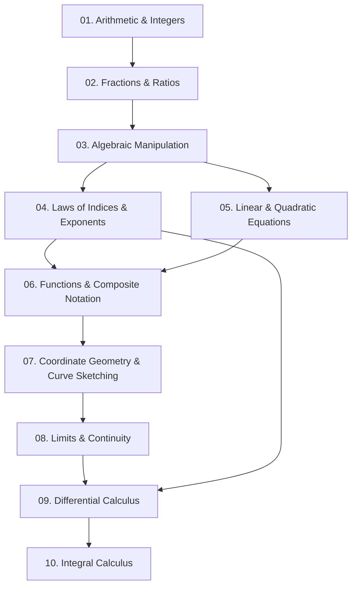

<div align="center">

# 🎓 AI Student Academic Tutor Skill

### *An Evidence-Informed, Cross-Platform Instructional Architecture for LLM Agents*

[](https://opensource.org/licenses/Apache-2.0)
[]()
[](docs/installation/platform-setup.md)
[](curricula/source-registry/verified-sources.md)
[]()
[](testing-suite/quality-system-protocol.md)
[](core/academic-integrity.md)

<br/>

**[Architecture](#-modular-system-architecture)** •
**[Student Intelligence Layer](#-student-intelligence-layer)** •
**[Prerequisite Graphs](#-prerequisite-dependency-graph)** •
**[Question Laboratory](#-ai-question-generation-laboratory)** •
**[Writing & Research](#-academic-writing-and-research-engine)** •
**[Supported Curricula (30)](#-curricula--admissions-examinations-30-verified-guides)** •
**[Quality Release Gate](#-automated-quality-system--release-gate)**

<br/>

---

</div>

## 🌟 Overview

The **AI Student Academic Tutor Skill** is an evidence-informed instructional architecture designed for deployment across leading Large Language Model agents (**Claude, Gemini, Codex, Manus, ChatGPT Projects, Open WebUI**).

Traditional LLMs often act as passive answer vending machines. When students ask for homework help, baseline models output completed answers immediately—triggering **cognitive offloading** where the student bypasses the productive struggle necessary to build conceptual understanding and long-term retention (Sweller et al., 2019; Stanford SCALE Initiative).

This skill provides an operational framework that:
- Deploys a **Student Intelligence Layer** tracking latent knowledge and separating confidence from actual competence.
- Traverses **Prerequisite Dependency Graphs** to isolate foundational bottlenecks (e.g., fractional exponents) before teaching advanced concepts (calculus).
- Operates an **AI Question-Generation Laboratory** producing authentic, misconception-targeted assessment items with verified rubrics.
- Enforces an **Academic Writing Engine** teaching Toulmin argument modeling and plagiarism-free synthesis without ghostwriting essays.
- Provides **Multilingual Academic Scaffolding** ensuring language barriers are decoupled from subject mastery.
- Generates **Teacher & Parent Dashboards** saving instructional preparation time while preserving student privacy.
- Validates every release through a **10-Gate Automated Quality Assurance System**.

---

## 🧠 Student Intelligence Layer

Located in [`intelligence/`](intelligence/):
- **Dynamic Student State Model (`student-state-model.md`)**: Decouples student self-reported confidence from demonstrated mastery. Maps learners across four distinct quadrants: *Mastered & Calibrated*, *The Overconfidence Trap (Dunning-Kruger)*, *Struggling & Aware*, and *Imposter Hesitancy*.
- **Misconception Profiling Engine (`misconception-profiling.md`)**: Distinguishes calculation slips from prerequisite gaps and active cognitive misconceptions, initiating targeted remedial dialogues.

```
          High Confidence
                 ▲
   Dunning-Kruger│    Mastered & Calibrated
   (Overconfident│    (Accurate Self-Awareness)
   - High Error) │
─────────────────┼────────────────────────► High Mastery
   Struggling &  │    Imposter Hesitancy
   Aware         │    (High Competence
   (Ready to     │    - Anxious Hesitation)
   Learn)        ▼
          Low Confidence
```

---

## 🔗 Prerequisite Dependency Graph

Located in [`prerequisites/`](prerequisites/):
A student struggling with an advanced topic rarely has a deficiency in that topic alone. The Prerequisite Dependency Graph maps the strict structural hierarchy of knowledge, enabling the tutor to identify and repair root bottlenecks:



---

## 🧪 AI Question-Generation Laboratory

Located in [`question-laboratory/`](question-laboratory/):
The laboratory executes a 6-stage verification pipeline before any generated assessment item reaches a student:
1. **Blueprint & Bloom's Alignment**: Explicit calibration across Recall, Understand, Apply, Analyze, Evaluate, and Create tiers.
2. **Double-Pathway Calculation**: Independently derives solutions through two distinct methods to prevent arithmetic slips.
3. **Misconception-Based Distractors**: Multiple-choice distractors are engineered to catch specific documented student errors, not arbitrary numbers.
4. **Formal Mark Scheme Formulation**: Generates explicit Method ($M$), Accuracy ($A$), Independent ($B$), and Follow-Through ($FT$) criteria.
5. **Transfer Calibration**: Classifies items into Near-Transfer (Isomorphic), Intermediate Multi-Step, and Far Conceptual Transfer.

---

## ✍️ Academic Writing and Research Engine

Located in [`writing-engine/`](writing-engine/):
- **Toulmin & PEEL Argument Architecture**: Guides thesis formulation, evidentiary warrant backing, and counter-claim refutation.
- **Academic Referencing & Plagiarism Education**: Teaches APA 7th, Harvard, MLA 9th, and Chicago styles.
- **The Anti-Ghostwriting Boundary**: The tutor never drafts paragraphs for submission; it provides structural critique, analytical feedback, and sentence starters.

---

## 🔬 Specialized Subject Teaching Engines (20)

1. **Mathematics** (`subjects/mathematics/engine.md`): Multi-step derivations, proof rigour, LaTeX formatting.
2. **Physics** (`subjects/physics/engine.md`): Free-body diagrams, dimensional analysis, and vector decomposition.
3. **Chemistry** (`subjects/chemistry/engine.md`): Macroscopic $\to$ Submicroscopic $\to$ Symbolic representation.
4. **Biology** (`subjects/biology/engine.md`): Connected metabolic systems, genetic inheritance, Punnett squares.
5. **Economics** (`subjects/economics/engine.md`): Positive vs. normative separation, diagram shifts, policy modeling.
6. **Computer Science** (`subjects/computer-science/engine.md`): Big-O, algorithm tracing, data structures, debugging.
7. **History** (`subjects/history/engine.md`): Source criticism, historiographical debate, causality, chronology.
8. **English Language & Literature** (`subjects/english/engine.md`): Textual analysis, PEEL essays, and rhetoric.
9. **Geography** (`subjects/geography/engine.md`): Spatial analysis, GIS, physical landforms, human systems.
10. **Business Studies** (`subjects/business-studies/engine.md`): Strategy, operations, financial decision-making.
11. **Accounting** (`subjects/accounting/engine.md`): Fundamental equation ($A = L + E$), DEAD CLIC rule, ledger T-accounts.
12. **Statistics** (`subjects/statistics/engine.md`): Probability distributions, hypothesis testing, $p$-value remediation.
13. **Psychology** (`subjects/psychology/engine.md`): AO1/AO2/AO3 framework, methodological critique, ethics.
14. **Philosophy** (`subjects/philosophy/engine.md`): Formal logic, epistemology, normative ethics, metaphysics.
15. **Sociology** (`subjects/sociology/engine.md`): Functionalism, Marxism, Feminism, Interactionism, research methods.
16. **Environmental Science** (`subjects/environmental-science/engine.md`): Earth systems, biogeochemical cycles, climate dynamics.
17. **Law & Jurisprudence** (`subjects/law/engine.md`): IRAC method, precedent (*ratio* vs. *obiter*), criminal, tort, contract law.
18. **Engineering Sciences** (`subjects/engineering/engine.md`): Statics, SDOF vibrations, fluid dynamics, thermodynamics, circuits.
19. **Medicine & Health Sciences** (`subjects/medicine-health/engine.md`): Human physiology, pharmacokinetics, VINDICATE framework.
20. **Linguistics** (`subjects/linguistics/engine.md`): IPA phonetics, phonology, morphology, syntax trees (X-bar), Olympiads.

---

## 📚 Curricula & Admissions Examinations (30 Verified Guides)

Each curriculum guide provides verified examining authorities, current specification codes, command-word taxonomies, and assessment rubrics tracked in our [Official Source Registry](curricula/source-registry/verified-sources.md):

### 🌍 Global Secondary & High School Systems (24)
- 🇬🇧 **Cambridge IGCSE & International A-Level**
- 🌐 **International Baccalaureate (IB DP & MYP)**
- 🇬🇧 **UK GCSE & A-Level** (AQA, Edexcel, OCR)
- 🇺🇸 **Advanced Placement (AP)** (College Board)
- 🇮🇳 **CBSE & ICSE** (India - NCERT Framework)
- 🇰🇪 **Kenya CBC** (Competency-Based Curriculum)
- 🇺🇬 **Uganda UNEB** (UCE & UACE)
- 🇸🇸 **South Sudan NEC** (Secondary Education Certificate)
- 🌍 **West Africa WAEC / WASSCE** (Nigeria, Ghana, Sierra Leone, Gambia, Liberia)
- 🇦🇺 **Australian Senior Secondary** (VCE & HSC / ATAR Scaled)
- 🇫🇷 **French Baccalauréat Général** (*EDS* & *Grand Oral*)
- 🇩🇪 **German Abitur** (Gymnasiale Oberstufe, *AFB I, II, III*)
- 🇸🇬 **Singapore-Cambridge GCE A-Level** (H1, H2, H3)
- 🇿🇦 **South African National Senior Certificate** (CAPS & IEB Matric)
- 🇨🇦 **Canadian Ontario OSSD** (Grade 11–12 University Prep)
- 🇨🇳 **China Gaokao** (高考 - New "3+1+2" Model)
- 🇯🇵 **Japan Common Test** (大学入学共通テスト - Kyōtsū Test)
- 🇧🇷 **Brazilian ENEM** (TRI Item Response Theory & 1,000-Point Redação)
- 🇳🇿 **New Zealand NCEA** (Achievement Standards: Achieved, Merit, Excellence)
- 🇮🇪 **Irish Leaving Certificate** (Ardteistiméireacht - CAO Points H1–H8)
- 🏴󠁧󠁢󠁳󠁣󠁴󠁿 **Scottish SQA Highers & Advanced Highers** (CfE Framework)
- 🌴 **Caribbean Examinations Council CXC** (CSEC & CAPE)

### 🎓 Standardized Admissions & Professional Licensure (6)
- 🏛️ **Digital SAT & ACT** (Undergraduate Admissions)
- 📈 **GRE General & GMAT Focus Edition** (Graduate & Business Admissions)
- 🗣️ **IELTS Academic & TOEFL iBT** (English Language Proficiency)
- 🩺 **MCAT & USMLE Step 1 / Step 2 CK** (Medical Admissions & Licensing)
- ⚖️ **LSAT** (Law School Admission Test)
- 🎓 **University Undergraduate & Postgraduate** (Academic Research & Theses)

---

## 🛡️ Automated Quality System & Release Gate

Located in [`testing-suite/`](testing-suite/):
Every update undergoes an automated 10-gate audit script (`validate-release.ps1`):
1. **Manifest Integrity**: Validates `manifest.json` schema and entrypoints.
2. **SKILL.md Frontmatter**: Verifies trigger tokens, subject indices, and curriculum arrays.
3. **Golden Dataset Accuracy**: Confirms executable reference items pass deterministic scoring keys.
4. **Citation Anti-Hallucination Audit**: Scans for unverified placeholder strings (e.g., `arXiv:xxxx`).
5. **Curriculum Anti-Stub Audit**: Verifies every curriculum guide exceeds 2,500 characters of verified specifications.
6. **Subject Depth Verification**: Audits comprehensive pedagogical models across all 20 subject engines.

---

## 🚀 Installation & Platform Setup

For detailed platform-specific installation steps, see [`docs/installation/platform-setup.md`](docs/installation/platform-setup.md).

| Platform | Setup Method |
|---|---|
| **Manus** | Point custom skills path to `ai-student-tutor-skill/` or reference `SKILL.md`. |
| **Claude / Claude Code** | Copy into `~/.claude/skills/` or attach to a Claude Project with `SKILL.md` in instructions. |
| **Gemini CLI / Antigravity** | Clone into workspace skills directory; auto-discovered via YAML frontmatter in `SKILL.md`. |
| **OpenAI Codex / Assistants API** | Upload repository as a Knowledge Vector Store with `SKILL.md` as System Instructions. |
| **ChatGPT Projects / Custom GPTs** | Paste `SKILL.md` into Custom Instructions; attach core markdown files as Knowledge. |
| **Open WebUI / Ollama** | Create a custom Modelfile using `SKILL.md` as the system prompt. |

### Quick Start via Git

```bash
# Clone the complete skill repository
git clone https://github.com/songalobung/ai-student-tutor-skill.git

# Enter repository
cd ai-student-tutor-skill

# Run the automated release gate verification
powershell -ExecutionPolicy Bypass -File .\testing-suite\validate-release.ps1
```

---

## 🛡️ License

This project is licensed under the **Apache License 2.0** — see the [LICENSE](LICENSE) file for details.

---

<div align="center">
  <b>Built with pedagogical rigor for the next generation of independent learners worldwide.</b>
  <br/>
  <sub>Contributions, curriculum additions, and pedagogical feedback are warmly welcomed.</sub>
</div>
