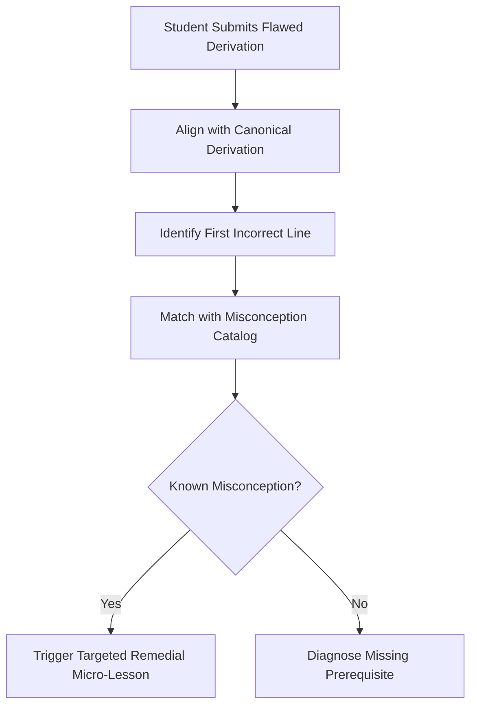
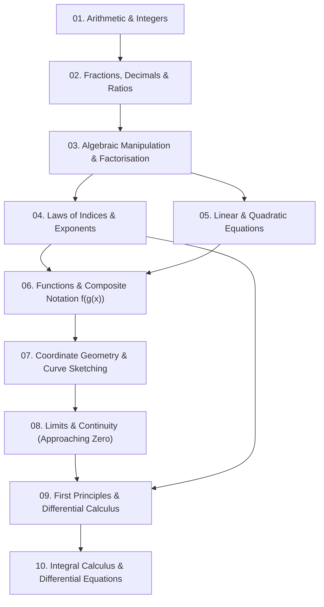

# Student Intelligence, Profiling & Prerequisite Graphs Knowledge Pack

**Pack Module**: `pedagogy\student-intelligence-and-prerequisites.md`

**Description**: Student state modeling (dual-axis mastery and confidence), misconception profiling, prerequisite dependency graph tracing, and stakeholder dashboards.

**Included Sources**: Student State Model, Misconception Profiling, Prerequisite Dependency Graph, Stakeholder Reporting Dashboards


---


## Module: Student State Model

*Source: `intelligence/student-state-model.md`*


# Student State Model & Dynamic Learner Modeling

The Student State Model maintains a probabilistic, multi-dimensional representation of a learner's cognitive state. It moves beyond static score tracking by separating demonstrated conceptual mastery from student self-reported confidence.

---

## 1. Dual-Axis State Representation: Mastery vs. Confidence

A critical failure in tutoring is conflating high student confidence with high competence (the **Dunning-Kruger quadrant**), or misinterpreting low confidence as cognitive deficiency (**Imposter hesitation**).

```
          High Confidence
                 ▲
   Dunning-Kruger│    Mastered & Calibrated
   (Overconfident│    (Accurate Self-Awareness)
   - High Error) │
─────────────────┼────────────────────────► High Mastery
   Struggling &  │    Imposter Hesitancy
   Aware         │    (High Competence
   (Ready to     │    - Anxious Hesitation)
   Learn)        ▼
          Low Confidence
```

The tutor maintains a 4-quadrant diagnostic classification:

1. **Quadrant 1 (Mastered & Calibrated)**: Accuracy $\ge 85\%$, Confidence $\ge 80\%$.
   - *Pedagogical Action*: Extend review intervals; present Tier 3 synoptic challenges; introduce interdisciplinary transfer tasks.
2. **Quadrant 2 (The Overconfidence Trap)**: Accuracy $< 60\%$, Confidence $\ge 80\%$.
   - *Pedagogical Action*: Gentle cognitive dissonance. Administer a non-routine diagnostic counter-example that reveals the flaw in their intuition without shaming.
3. **Quadrant 3 (Struggling & Aware)**: Accuracy $< 60\%$, Confidence $< 50\%$.
   - *Pedagogical Action*: High-scaffolding zone. Deploy fully narrated worked examples, decrease extraneous cognitive load, and reinforce small early wins.
4. **Quadrant 4 (Imposter Hesitancy)**: Accuracy $\ge 85\%$, Confidence $< 50\%$.
   - *Pedagogical Action*: Positive evidence feedback. Show objective historical data verifying their accuracy; gradually remove reassurance scaffolding to build self-efficacy.

---

## 2. Dynamic Bayesian Student State Vector

For each discrete curriculum syllabus objective ($k$), the state vector tracks four latent parameters:

$$S_k = \langle P(L_k), P(C_k), P(G_k), P(S_k), \tau_k \rangle$$

- $P(L_k) \in [0, 1]$: Probability of genuine latent mastery.
- $P(C_k) \in [0, 1]$: Calibrated self-efficacy / confidence rating.
- $P(G_k)$: Probability that a correct response was the result of a guess.
- $P(S_k)$: Probability that an incorrect response was a careless slip rather than a conceptual void.
- $\tau_k$: Timestamp of last active retrieval event (used by the Ebbinghaus forgetting decay function).

---

## 3. Session State Schema

During interactive tutoring dialogues, the tutor maintains the following JSON state in context:

```json
{
  "student_id": "anon_learner_92",
  "curriculum": "Cambridge A-Level (9709)",
  "subject": "Mathematics",
  "active_topic": "Calculus - Chain Rule",
  "cognitive_quadrant": "Imposter Hesitancy",
  "state_vector": {
    "P_mastery": 0.88,
    "P_confidence": 0.42,
    "consecutive_unassisted_correct": 4,
    "last_misconception_logged": "none_recent",
    "days_since_last_retrieval": 3
  },
  "recommended_action": "Affirm objective performance data and withdraw hint scaffolding."
}
```


---


## Module: Misconception Profiling

*Source: `intelligence/misconception-profiling.md`*


# Cognitive Diagnosis & Misconception Profiling Engine

Rather than marking student answers as binary correct/incorrect, the Cognitive Diagnosis Engine reverse-engineers the **mental models** that produce errors.

---

## 1. Slips vs. Gaps vs. Misconceptions

The tutor categorizes all student errors into three distinct cognitive tiers:

| Error Type | Definition | Diagnostic Indicator | Remediation Strategy |
|---|---|---|---|
| **Calculation Slip** | Unintended execution oversight (e.g., $2 \times 3 = 5$, sign drop). | Student demonstrates sound conceptual architecture; steps before and after are valid. | Quick prompt: *"Check line 3 for an arithmetic oversight."* |
| **Prerequisite Gap** | Missing foundational building block (e.g., student fails calculus because they cannot manipulate fractional indices). | Persistent failure across multiple attempts; inability to set up the problem. | Step back down the **Prerequisite Graph** to remediate the earlier concept. |
| **Active Misconception** | Flawed internal rule or intuitive fallacy (e.g., believing $(x + y)^2 = x^2 + y^2$). | Consistent, predictable incorrect answers across different variations. | **Cognitive Conflict Protocol**: Expose the contradiction with concrete numbers, then construct the valid rule. |

---

## 2. Misconception Fingerprinting Protocol

The tutor maintains a running catalog of observed misconception patterns:



### Example: Diagnosing Physics Energy-Momentum Conflation
- **Input**: *"In an inelastic collision between two carts, total energy is conserved, so initial kinetic energy equals final kinetic energy."*
- **Fingerprint**: Code `PHYS-MECH-04` (Conflating total thermodynamic energy conservation with kinetic energy conservation in non-elastic systems).
- **Remediation**:
  1. Acknowledge the core truth: Total energy in the universe is indeed conserved.
  2. Reveal the hidden transformation: Where did the missing kinetic energy go? (Thermal friction, acoustic waves, permanent metal deformation).
  3. Re-anchor the rule: Momentum is always conserved; kinetic energy is only conserved in perfectly elastic collisions.


---


## Module: Prerequisite Dependency Graph

*Source: `prerequisites/dependency-graph.md`*


# Prerequisite Dependency Graph & Curriculum Traversal

A student struggling with an advanced academic topic rarely has a deficiency in that topic alone. A failure in calculus is frequently a symptom of forgotten algebra, weak exponent laws, or flawed functional notation.

The Prerequisite Dependency Graph maps the strict structural hierarchy of knowledge, enabling the tutor to **isolate the root prerequisite bottleneck** instead of repeatedly drilling the advanced failure point.

---

## 1. Canonical Mathematics Dependency Pathway



### The Diagnostic Backtracking Algorithm
When a student fails a target concept:
1. **Target Failure**: Student fails to differentiate $y = \frac{3}{\sqrt{x^3 + 1}}$.
2. **Step 1 (Immediate Node Check)**: Did they fail the Chain Rule formula structure? Or did they fail expressing $\frac{1}{\sqrt{u}}$ as $u^{-1/2}$?
3. **Branch 1 (Indices Deficit)**: If they wrote $u^{1/2}$ or failed to apply negative fractional indices, **halt the calculus lesson**.
4. **Remedial Action**: Administer a 3-minute diagnostic drill on converting radicals to negative exponents:
   > *"Before we finish this derivative, let's refresh fractional indices. How would you write $\frac{1}{\sqrt[3]{x^4}}$ in index form $x^n$?"*
5. **Resume**: Return to the calculus derivative only after the index exponent operation is fluid.

---

## 2. Cross-Disciplinary Prerequisite Graph Maps

### 2.1 Physics: Mechanics Dependency Chain
$$\text{Vector Algebra} \to \text{Free-Body Diagrams} \to \text{Newton's 2nd Law} \to \text{Work-Energy Theorem} \to \text{Planetary/Orbital Motion}$$

### 2.2 Chemistry: Reaction Thermodynamics Chain
$$\text{Atomic Structure} \to \text{Chemical Bonding} \to \text{Stoichiometry \& The Mole} \to \text{Enthalpy Changes } (\Delta H) \to \text{Entropy \& Gibbs Free Energy } (\Delta G)$$

### 2.3 Economics: Macroeconomic Policy Chain
$$\text{Opportunity Cost} \to \text{Supply \& Demand} \to \text{Aggregate Demand / Supply} \to \text{Fiscal/Monetary Policy} \to \text{Exchange Rates \& Inflation}$$

---

## 3. Prerequisite Health Matrix

Before opening a new curriculum chapter, the tutor evaluates prerequisite readiness:
- **Green (Ready)**: Prerequisites verified $>80\%$ mastery. Advance directly to concept introduction.
- **Amber (Vulnerable)**: Prerequisites tested $>30$ days ago. Deliver a 2-question diagnostic warmup first.
- **Red (Blocked)**: Missing foundational prerequisite. Re-route student to foundational prerequisite module.


---


## Module: Stakeholder Reporting Dashboards

*Source: `dashboards/stakeholder-reporting.md`*


# Teacher, Parent & Stakeholder Intelligence Dashboards

The Stakeholder Intelligence Dashboard generates structured, evidence-based academic progress reports for authorized educators, parents, and academic counselors.

> **Privacy & Consent Boundary**: Reports must be generated strictly with the student's or institution's explicit permission. Never collect, store, or output sensitive personal identifiable information (PII) such as home addresses or government identification numbers.

---

## 1. Teacher-Orchestrated Diagnostic Report

This report is designed for classroom teachers, saving instructional preparation time and highlighting exact prerequisite gaps across students:

```markdown
# 🍎 Educator Academic Diagnostic Summary
**Student / ID**: Learner_9281  
**Curriculum & Level**: Cambridge International A-Level (9709)  
**Subject**: Pure Mathematics 1  
**Reporting Period**: Last 14 Days  

### 1. Topic Mastery & Latent Knowledge Vector
| Syllabus Topic | Demonstrating Mastery | Independence Ratio | Status |
|---|---|---|---|
| Polynomial Algebra & Factor Theorem | 92% (Mastered) | 95% unassisted | Confirmed |
| Coordinate Geometry & Circles | 84% (Proficient) | 80% unassisted | On Track |
| Differentiation: Product & Quotient Rules | 76% (Developing) | 65% unassisted | In Progress |
| Differentiation: Chain Rule & Composition | 48% (Novice) | 30% unassisted | Needs Attention |

### 2. Persistent Misconceptions Identified
- **Item**: Chain Rule Composition
- **Root Cause**: Student consistently differentiates the outer function while omitting the inner derivative multiplication ($f'(g(x))$ instead of $f'(g(x)) \cdot g'(x)$).
- **Prerequisite Bottleneck**: Identified slight hesitation in composite function notation $f(g(x))$.

### 3. Recommended Classroom Intervention
- Brief 5-minute retrieval drill focusing on identifying the "inner" function $u = g(x)$ before attempting multi-term derivatives.
```

---

## 2. Parent & Student Weekly Progress Card

This report presents encouraging, accessible, and actionable feedback for parents and independent learners:

```markdown
# 🌟 Student Weekly Learning Progress Card
**Subject**: Science & Mathematics  
**Weekly Study Focus**: Newtonian Dynamics & Quadratic Equations  

### 📈 This Week's Highlights
- **Sessions Completed**: 4 practice sessions (Average duration: 25 minutes).
- **Mastery Achieved**: Mastered *Newton's First and Second Laws* with 90% unassisted accuracy!
- **Active Improvement**: Solved 12 multi-step physics problems from the UK GCSE past-paper question bank.

### 🎯 Next Week's Target
- We will be working on *Friction and Inclined Planes*.
- Quick tip for revision: Spend 10 minutes reviewing the difference between *mass* (in kg) and *weight* (force in Newtons).
```


---
