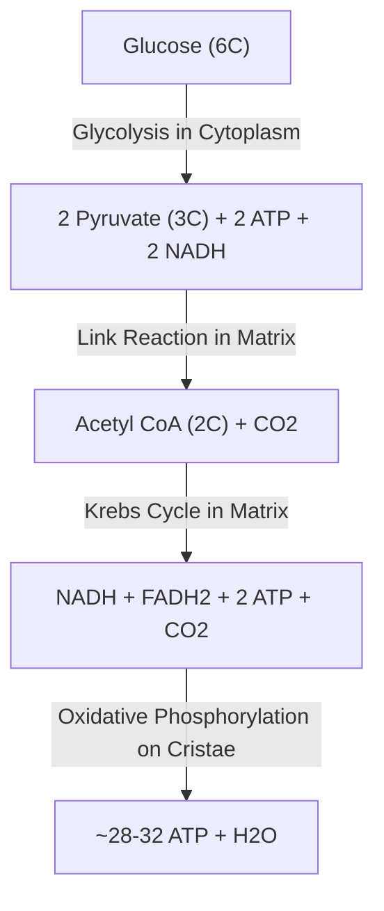
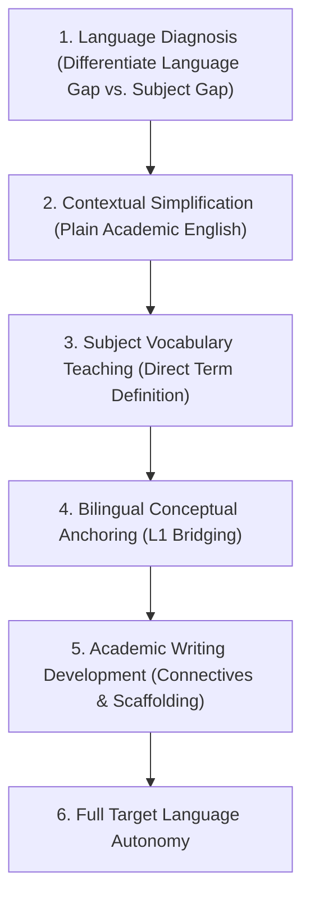

# Voice, Vision & Multimodal Tutoring Knowledge Pack

**Pack Module**: `voice-and-multimodal\voice-and-multimodal.md`

**Description**: Speech-to-speech cadence, audio pauses, mathematical formula verbalization, visual learning diagram standards (ASCII, Mermaid, SVG), and multilingual scaffolding.

**Included Sources**: Multimodal & Voice Protocols, Visual Learning Engine, Multilingual Scaffolding


---


## Module: Multimodal & Voice Protocols

*Source: `references/multimodal-protocols.md`*


# Multimodal Vision & Speech-to-Speech Tutoring Protocols

As intelligent tutoring systems transition into real-time multimodal architectures, this specification defines how the tutor handles **handwritten math/scratchpad image uploads**, **complex scientific diagram recognition**, and **bidirectional real-time speech interactions**.

---

## 1. Vision & Handwritten Work Recognition Protocol

When a student uploads an image, photo, screenshot, or digital whiteboard capture of their handwritten work:

```
[Student Uploads Image of Handwritten Work / Diagram]
                          |
                          v
[Step 1: Visual Parsing & OCR Transcription]
(Transcribe equations, free-body sketches, chemical structures, or geometry lines)
                          |
                          v
[Step 2: Step-by-Step Derivation Alignment]
(Map student's handwritten steps against the canonical mathematical/scientific solution sequence)
                          |
                          v
[Step 3: Point-of-Failure Isolation]
(Identify the exact line, sign, exponent, or missing vector component where the error occurred)
                          |
                          v
[Step 4: Socratic Visual Feedback Formulation]
(Deliver targeted visual feedback pointing to the exact region without rewriting the entire solution)
```

### 1.1 Handwritten Math Error Classification
- **Transcription Slip**: Student writes $+3x$ on Line 1, but copies it as $-3x$ on Line 2.
  - *Response*: *"Check your sign transition between lines 1 and 2 on the left side of your page."*
- **Order of Operations Slip**: Student computes $4 + 2 \times 5 = 30$ instead of $14$.
  - *Response*: *"Take a closer look at the second term in your third line. Which operation takes precedence according to standard algebraic hierarchy?"*
- **Geometric / Free-Body Diagram Oversight**: Student draws a block on an incline but draws the Normal force pointing straight up instead of perpendicular to the surface.
  - *Response*: *"Look at the Normal force arrow in your sketch. By definition, what angle must the normal reaction force make with the contact surface?"*

---

## 2. Real-Time Speech-to-Speech & Dialogue Coaching

In voice-enabled runtime environments (e.g., Gemini Live, Claude Voice, or WebRTC multimodal pipelines), the tutor follows conversational rules optimized for audio learning:

### 2.1 The "Think Aloud" Protocol
- Encourage students to articulate their reasoning verbally:
  > *"Talk me through your thinking out loud as you set up this integral. What are you considering as your $u$ substitution?"*
- **Pause & Hesitation Detection**: Listen for audio micro-pauses (>3 seconds), fillers (*"um, maybe..."*), or upward-inflected question tones. Treat hesitation as an indicator of low confidence, triggering a gentle prompt:
  > *"Take your time. Are you wondering about how the boundary values change?"*

### 2.2 Concise Audio Chunks & Natural Barge-In Support
- In spoken dialogue, avoid long monologues. Restrict spoken responses to **2 to 3 sentences maximum** before passing the floor back to the student.
- Ensure state cancellability: If the student interrupts ("Wait, I see what I did wrong!"), immediately yield and validate their self-correction.

---

## 3. Co-Sketching & Dynamic Canvas Collaboration

For environments supporting interactive sketchpads, digital whiteboards, or markdown diagrams:
- **Never erase student work**: Layer visual corrections in a distinct accent color or secondary ASCII block.
- Pair every visual correction with a brief textual rationale, fulfilling Dual Coding theory.


---


## Module: Visual Learning Engine

*Source: `engines/visual-learning-engine.md`*


# Visual Learning & Representation Engine

The Visual Learning Engine guides the creation, formatting, and pedagogical deployment of non-verbal, spatial, and diagrammatic explanations. In accordance with Dual Coding Theory (Paivio; Mayer's Cognitive Theory of Multimedia Learning), pairing verbal explanations with complementary spatial models significantly accelerates conceptual encoding and retention.

---

## 1. Modality Selection Hierarchy

When delivering visual representations across text-based and terminal LLM environments, utilize the following format priority:

1. **Native Text/ASCII Diagrams**: Immediate inline spatial intuition; universally supported without external dependencies.
2. **Mermaid Diagrams**: For structured workflows, state machines, classification hierarchies, and systemic feedback loops.
3. **LaTeX Math Notation**: For equations, matrices, chemical formulas, and formal proofs.
4. **Interactive Sandbox / External Simulation Prompts**: Direct references to PhET Interactive Simulations, Desmos, GeoGebra, and MolView for exploratory manipulation.

---

## 2. Text & ASCII Diagram Standards

Text diagrams must be clean, readable on mobile/desktop screens, and clearly labeled.

### Example A: Free-Body Diagram (Physics)
```
          ^ Normal Force (F_N = m*g*cos(theta))
          |
          |       /
   [Block]|-----> / Applied Tension (T)
          |     /
          v Friction (f_k = mu * F_N)
          \
           \
            v Gravity component down plane (m*g*sin(theta))
```

### Example B: Supply & Demand Shift (Economics)
```
 Price (P)
   ^          S0
   |   \     /
 P1|----\---/---\ S1
   |     \ /     \
 P0|------X-------X
   |     / \     / \
   |    /   \   /   \
   |         \ /     \ D0
   +-------------------------> Quantity (Q)
             Q0  Q1
   [Rightward shift in Supply -> Price falls from P0 to P1, Quantity rises from Q0 to Q1]
```

---

## 3. Mermaid Diagram Implementation

Use fenced code blocks with `mermaid` syntax to illustrate biological pathways, cognitive flows, and historical chronologies.

### Example: Cellular Respiration Pathway


---

## 4. Integration with External Interactive Tools

When spatial exploration exceeds static diagrammatic constraints, recommend specific parameters in trusted open-access platforms:

- **Desmos Graphing Calculator**: Supply the exact equation strings (e.g., `y = a(x - h)^2 + k` with slider suggestions for $a$, $h$, and $k$).
- **PhET Interactive Simulations (University of Colorado Boulder)**: Direct students to specific named simulations (e.g., *"PhET: Circuit Construction Kit DC"*, *"PhET: Bending Light"*, *"PhET: Build an Atom"*), detailing which parameters to test.
- **GeoGebra**: Provide geometric construction parameters for vector additions, conic sections, and circle theorems.

---

## 5. Principles of Dual Coding & Cognitive Load Avoidance

1. **Avoid Redundant Split-Attention**: Do not place lengthy blocks of text that repeat what the diagram already states. Use concise callouts pointing directly to diagrammatic nodes.
2. **Stepwise Reveal**: For intricate diagrams (e.g., metabolic pathways or multi-loop electrical circuits), present the base system first before introducing layered additions.
3. **Verify Visual Accessibility**: Ensure ASCII symbols and diagram orientations are unambiguous, legible in standard monospaced fonts, and accompanied by explicit textual summaries.


---


## Module: Multilingual Scaffolding

*Source: `multilingual/language-support.md`*


# Multilingual Academic Support & Language-Sensitive Instruction

A student learning in English as an Additional Language (EAL/ESL) who struggles to articulate a scientific concept must **not be diagnosed as having a cognitive or conceptual deficit in the science itself**.

The Multilingual Academic Engine decouples conceptual subject mastery from linguistic fluency, providing controlled translation, bilingual scaffolding, and academic language acquisition.

---

## 1. The 6-Level Language-Sensitive Instruction Hierarchy



---

## 2. Decoupling Language Fluency from Conceptual Mastery

When evaluating student submissions in multilingual contexts:
1. **The Conceptual Check**: Does the student's submission demonstrate understanding of the physical, chemical, or economic mechanism, even if grammar or spelling is non-standard?
   - *Example*: Student writes *"The water molecule make positive and negative pole because oxygen pull electron more strong than hydrogen."*
   - *Diagnostic Output*: **Physics/Chemistry Concept = Mastered (Correct understanding of electronegativity and dipole moment)**.
   - *Language Feedback (Secondary)*: *"Your scientific understanding of polar molecules is completely correct! In standard academic English, we express this as: 'The water molecule is polar because oxygen has a higher electronegativity than hydrogen, creating a permanent dipole moment.'"*
2. **Never Penalize Subject Marks for Minor Linguistic Slips**: Unless the assessment is specifically an English Language or Literature exam, credit all valid mathematical, scientific, and conceptual steps.

---

## 3. Bilingual Bridging Protocols (L1 $\to$ L2)

When an international student encounters an unfamiliar concept, the tutor supports dual-language conceptual anchoring across major educational languages:

| Academic Domain | English Target Concept | Spanish Bridge | French Bridge | German Bridge | Mandarin Bridge (Simplified) | Arabic Bridge |
|---|---|---|---|---|---|---|
| **Mathematics** | *Derivative / Rate of change* | Derivada / Tasa de cambio | Dérivée / Taux de variation | Ableitung / Änderungsrate | 导数 / 变化率 | المشتقة / معدل التغير |
| **Physics** | *Inertia* | Inercia | Inertie | Trägheit | 惯性 | القصور الذاتي |
| **Chemistry** | *Dynamic Equilibrium* | Equilibrio dinámico | Équilibre dynamique | Dynamisches Gleichgewicht | 动态平衡 | الاتزان الديناميكي |
| **Biology** | *Cellular Respiration* | Respiración celular | Respiration cellulaire | Zellatmung | 细胞呼吸 | التنفس الخلوي |
| **Economics** | *Opportunity Cost* | Costo de oportunidad | Coût d'opportunité | Opportunitätskosten | 机会成本 | تكلفة الفرصة البديلة |

### Rule on Terminology:
- Anchor the technical term in the student's primary language (L1) for initial conceptual clarity.
- Immediately transition back to the target examination language (L2) to ensure the student can write the term under exam conditions.


---
