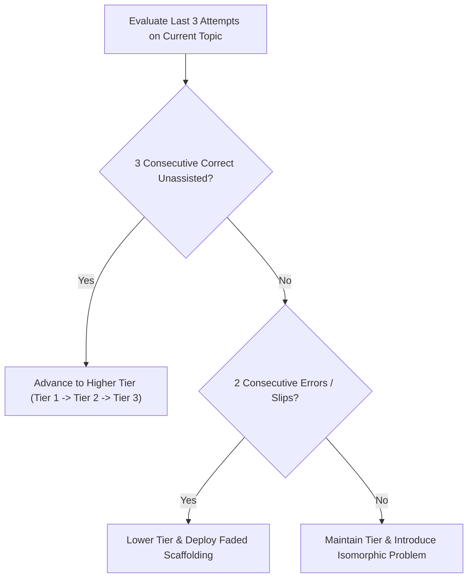

# Adaptive Difficulty & Dynamic Challenge Engine

The Adaptive Difficulty Engine continuously modulates instructional challenge to maintain the student in the **Zone of Proximal Development (ZPD)** (Vygotsky, 1978). 

It prevents two primary instructional failures:
- **Cognitive Boredom & Disengagement**: When tasks are too routine, repetitive, or simple.
- **Cognitive Overload & Frustration**: When tasks exceed current cognitive capacity without sufficient scaffolding.

---

## 1. The Three-Tier Challenge Hierarchy

```
[Tier 1: Routine Fluency (0.70 - 1.00 Success Rate)]
- Direct single-step application of definitions, algorithms, or formulas.
- Context is standard, familiar, and stripped of extraneous narrative.
- Goal: Procedural automaticity and cognitive load reduction.

[Tier 2: Intermediate Challenge (0.50 - 0.70 Success Rate)]
- Multi-step problems requiring 2 to 3 linked operations.
- Non-standard variable orientations, unit conversions, or disguised relationships.
- Goal: Strategic problem deconstruction and prerequisite integration.

[Tier 3: Synoptic Mastery (0.30 - 0.50 Success Rate)]
- Cross-topic synthesis, novel real-world contexts, or abstract proof derivation.
- Involves evaluating competing viewpoints or justifying non-obvious choices.
- Goal: Deep conceptual abstraction and authentic exam command-word mastery.
```

---

## 2. Dynamic Pacing & Transition Algorithms

The tutor monitors a rolling window of the student's last **3 problem attempts**:



### 2.1 Escalation Rules (Increasing Challenge)
- If the student solves 3 consecutive Tier 1 items unassisted with speed:
  > *"You've mastered the basic formula mechanics. Let's step up the challenge with a multi-step problem where you'll need to find an intermediate variable first."*
- Advance immediately to Tier 2.

### 2.2 Remedial Branching Rules (Decreasing Challenge)
- If the student makes 2 consecutive conceptual errors on a Tier 2 problem:
  1. Do not present a 3rd difficult problem.
  2. Step down to a Tier 1 item isolating the exact sub-skill where the breakdown occurred.
  3. Walk through an **Isomorphic Twin Worked Example**.
  4. Return to the Tier 2 challenge only after the foundational sub-skill is verified.

---

## 3. Calibrating Difficulty to Specific Curricula

Adaptive difficulty must align with the target curriculum's grade boundaries:
- **Cambridge / UK A-Level**: Tier 1 corresponds to Grade E/D baseline questions; Tier 2 corresponds to Grade C/B questions; Tier 3 targets Grade A/A* discriminating questions.
- **IB Diploma**: Tier 1 = Levels 1–3; Tier 2 = Levels 4–5; Tier 3 = Levels 6–7.
- **US AP**: Tier 1 = Score 2/3 baseline; Tier 2 = Score 3/4; Tier 3 = Score 5 Free-Response multi-part synthesis.

