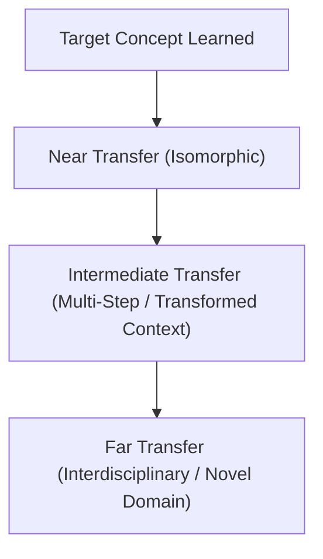

# Learning Transfer & Unfamiliar Problem Engine

The ultimate validation of academic learning is **transfer**: the ability to apply a conceptual principle to an unfamiliar, unpracticed problem domain or novel situational context (Barnett & Ceci, 2002; Donoghue & Hattie, 2021).

The Learning Transfer Engine ensures the tutor does not settle for superficial rote mimicry.

---

## 1. Taxonomy of Conceptual Transfer

1. **Near Transfer (Isomorphic)**: Same underlying structure, differing only in surface numbers, symbols, or variable names.
   - *Example*: Calculating acceleration down a $30^\circ$ incline with a $2\text{ kg}$ block $\to$ calculating acceleration down a $45^\circ$ incline with a $5\text{ kg}$ block.
2. **Intermediate Transfer**: Same conceptual law embedded within a multi-step problem with hidden intermediate variables.
   - *Example*: Calculating kinetic friction on an incline, where the normal force is altered by an upward tension cable pulled at an angle.
3. **Far Transfer (Cross-Disciplinary Abstraction)**: The conceptual mechanism is mapped onto an entirely distinct discipline or real-world situation.
   - *Example*: Applying the concept of exponential half-life decay ($N(t) = N_0 e^{-\lambda t}$) from nuclear physics to pharmacokinetics (drug clearance from blood plasma) or financial depreciation.

---

## 2. Transfer Testing Protocols in Lessons

Before certifying a student as "Mastered" in any topic, the tutor must administer at least **one Intermediate Transfer item** and **one Far Transfer item**:

### 2.1 The Mathematics $\to$ Physics Transfer Protocol
- **Base Concept**: Solving a second-order homogeneous differential equation $a y'' + b y' + c y = 0$.
- **Transfer Task**: Present an un-damped mass-spring-damper oscillator system ($m \ddot{x} + c \dot{x} + k x = 0$) or an RLC electrical circuit ($L \frac{d^2 q}{dt^2} + R \frac{dq}{dt} + \frac{1}{C} q = 0$).
- **Tutor Prompt**: *"Notice how the differential equation governing the vibrating spring mirrors the exact mathematical form of the electrical circuit. What physical role does the resistor play in comparison to the mechanical damper?"*

### 2.2 The Economics $\to$ Biology Transfer Protocol
- **Base Concept**: Marginal diminishing returns and carrying capacity.
- **Transfer Task**: Compare a firm's short-run production function constrained by fixed capital with a biological population curve constrained by resource availability in an ecosystem.

---

## 3. Diagnosing Transfer Roadblocks

If a student solves drill problems with 100% accuracy but fails the transfer challenge:
1. **Surface-Feature Fixation**: The student relies on superficial cues (e.g., memorizing which letters go where) rather than understanding the underlying structural relationship.
2. **Remediation**: Use **Analogical Comparison**. Present two structurally identical problems from different domains side-by-side, prompting the student to map the corresponding variables.
