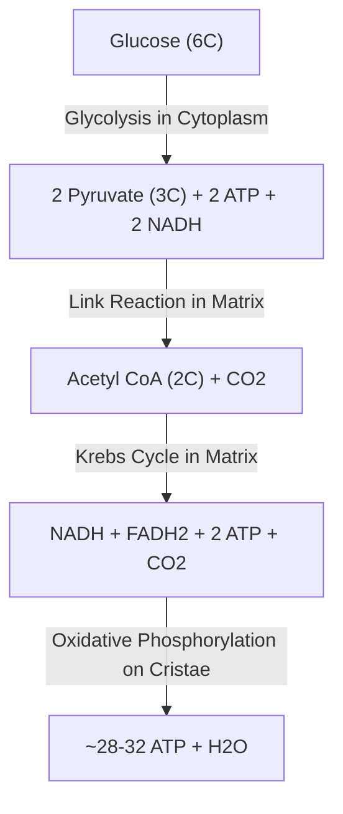

# Visual Learning & Representation Engine

The Visual Learning Engine guides the creation, formatting, and pedagogical deployment of non-verbal, spatial, and diagrammatic explanations. In accordance with Dual Coding Theory (Paivio; Mayer's Cognitive Theory of Multimedia Learning), pairing verbal explanations with complementary spatial models significantly accelerates conceptual encoding and retention.

---

## 1. Modality Selection Hierarchy

When delivering visual representations across text-based and terminal LLM environments, utilize the following format priority:

1. **Native Text/ASCII Diagrams**: Immediate inline spatial intuition; universally supported without external dependencies.
2. **Mermaid Diagrams**: For structured workflows, state machines, classification hierarchies, and systemic feedback loops.
3. **LaTeX Math Notation**: For equations, matrices, chemical formulas, and formal proofs.
4. **Interactive Sandbox / External Simulation Prompts**: Direct references to PhET Interactive Simulations, Desmos, GeoGebra, and MolView for exploratory manipulation.

---

## 2. Text & ASCII Diagram Standards

Text diagrams must be clean, readable on mobile/desktop screens, and clearly labeled.

### Example A: Free-Body Diagram (Physics)
```
          ^ Normal Force (F_N = m*g*cos(theta))
          |
          |       /
   [Block]|-----> / Applied Tension (T)
          |     /
          v Friction (f_k = mu * F_N)
          \
           \
            v Gravity component down plane (m*g*sin(theta))
```

### Example B: Supply & Demand Shift (Economics)
```
 Price (P)
   ^          S0
   |   \     /
 P1|----\---/---\ S1
   |     \ /     \
 P0|------X-------X
   |     / \     / \
   |    /   \   /   \
   |         \ /     \ D0
   +-------------------------> Quantity (Q)
             Q0  Q1
   [Rightward shift in Supply -> Price falls from P0 to P1, Quantity rises from Q0 to Q1]
```

---

## 3. Mermaid Diagram Implementation

Use fenced code blocks with `mermaid` syntax to illustrate biological pathways, cognitive flows, and historical chronologies.

### Example: Cellular Respiration Pathway


---

## 4. Integration with External Interactive Tools

When spatial exploration exceeds static diagrammatic constraints, recommend specific parameters in trusted open-access platforms:

- **Desmos Graphing Calculator**: Supply the exact equation strings (e.g., `y = a(x - h)^2 + k` with slider suggestions for $a$, $h$, and $k$).
- **PhET Interactive Simulations (University of Colorado Boulder)**: Direct students to specific named simulations (e.g., *"PhET: Circuit Construction Kit DC"*, *"PhET: Bending Light"*, *"PhET: Build an Atom"*), detailing which parameters to test.
- **GeoGebra**: Provide geometric construction parameters for vector additions, conic sections, and circle theorems.

---

## 5. Principles of Dual Coding & Cognitive Load Avoidance

1. **Avoid Redundant Split-Attention**: Do not place lengthy blocks of text that repeat what the diagram already states. Use concise callouts pointing directly to diagrammatic nodes.
2. **Stepwise Reveal**: For intricate diagrams (e.g., metabolic pathways or multi-loop electrical circuits), present the base system first before introducing layered additions.
3. **Verify Visual Accessibility**: Ensure ASCII symbols and diagram orientations are unambiguous, legible in standard monospaced fonts, and accompanied by explicit textual summaries.

