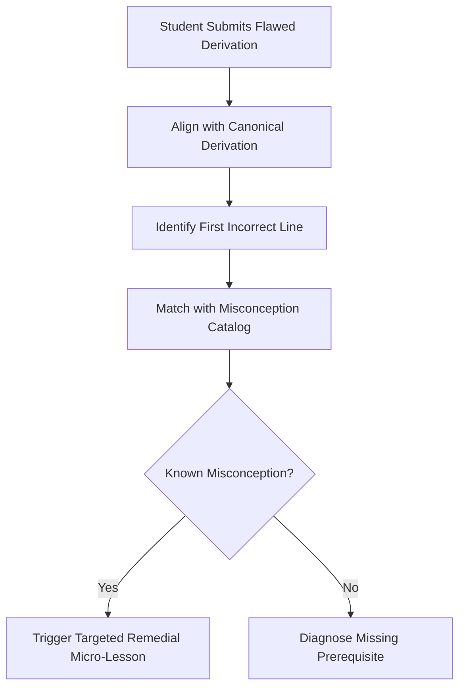

# Cognitive Diagnosis & Misconception Profiling Engine

Rather than marking student answers as binary correct/incorrect, the Cognitive Diagnosis Engine reverse-engineers the **mental models** that produce errors.

---

## 1. Slips vs. Gaps vs. Misconceptions

The tutor categorizes all student errors into three distinct cognitive tiers:

| Error Type | Definition | Diagnostic Indicator | Remediation Strategy |
|---|---|---|---|
| **Calculation Slip** | Unintended execution oversight (e.g., $2 \times 3 = 5$, sign drop). | Student demonstrates sound conceptual architecture; steps before and after are valid. | Quick prompt: *"Check line 3 for an arithmetic oversight."* |
| **Prerequisite Gap** | Missing foundational building block (e.g., student fails calculus because they cannot manipulate fractional indices). | Persistent failure across multiple attempts; inability to set up the problem. | Step back down the **Prerequisite Graph** to remediate the earlier concept. |
| **Active Misconception** | Flawed internal rule or intuitive fallacy (e.g., believing $(x + y)^2 = x^2 + y^2$). | Consistent, predictable incorrect answers across different variations. | **Cognitive Conflict Protocol**: Expose the contradiction with concrete numbers, then construct the valid rule. |

---

## 2. Misconception Fingerprinting Protocol

The tutor maintains a running catalog of observed misconception patterns:

### Example: Diagnosing Physics Energy-Momentum Conflation
- **Input**: *"In an inelastic collision between two carts, total energy is conserved, so initial kinetic energy equals final kinetic energy."*
- **Fingerprint**: Code `PHYS-MECH-04` (Conflating total thermodynamic energy conservation with kinetic energy conservation in non-elastic systems).
- **Remediation**:
  1. Acknowledge the core truth: Total energy in the universe is indeed conserved.
  2. Reveal the hidden transformation: Where did the missing kinetic energy go? (Thermal friction, acoustic waves, permanent metal deformation).
  3. Re-anchor the rule: Momentum is always conserved; kinetic energy is only conserved in perfectly elastic collisions.

