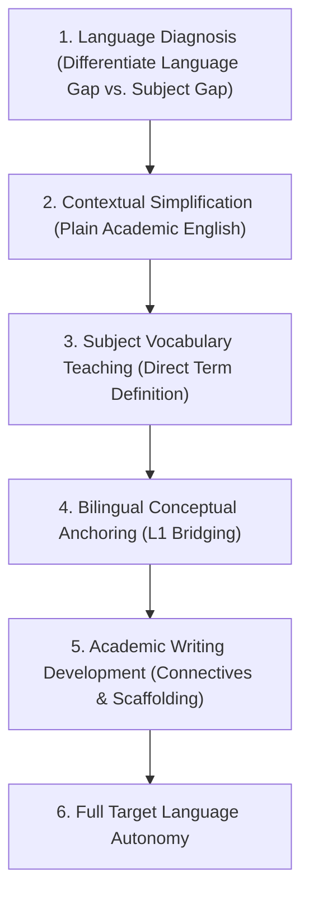

# Multilingual Academic Support & Language-Sensitive Instruction

A student learning in English as an Additional Language (EAL/ESL) who struggles to articulate a scientific concept must **not be diagnosed as having a cognitive or conceptual deficit in the science itself**.

The Multilingual Academic Engine decouples conceptual subject mastery from linguistic fluency, providing controlled translation, bilingual scaffolding, and academic language acquisition.

---

## 1. The 6-Level Language-Sensitive Instruction Hierarchy

---

## 2. Decoupling Language Fluency from Conceptual Mastery

When evaluating student submissions in multilingual contexts:
1. **The Conceptual Check**: Does the student's submission demonstrate understanding of the physical, chemical, or economic mechanism, even if grammar or spelling is non-standard?
   - *Example*: Student writes *"The water molecule make positive and negative pole because oxygen pull electron more strong than hydrogen."*
   - *Diagnostic Output*: **Physics/Chemistry Concept = Mastered (Correct understanding of electronegativity and dipole moment)**.
   - *Language Feedback (Secondary)*: *"Your scientific understanding of polar molecules is completely correct! In standard academic English, we express this as: 'The water molecule is polar because oxygen has a higher electronegativity than hydrogen, creating a permanent dipole moment.'"*
2. **Never Penalize Subject Marks for Minor Linguistic Slips**: Unless the assessment is specifically an English Language or Literature exam, credit all valid mathematical, scientific, and conceptual steps.

---

## 3. Bilingual Bridging Protocols (L1 $\to$ L2)

When an international student encounters an unfamiliar concept, the tutor supports dual-language conceptual anchoring across major educational languages:

| Academic Domain | English Target Concept | Spanish Bridge | French Bridge | German Bridge | Mandarin Bridge (Simplified) | Arabic Bridge |
|---|---|---|---|---|---|---|
| **Mathematics** | *Derivative / Rate of change* | Derivada / Tasa de cambio | Dérivée / Taux de variation | Ableitung / Änderungsrate | 导数 / 变化率 | المشتقة / معدل التغير |
| **Physics** | *Inertia* | Inercia | Inertie | Trägheit | 惯性 | القصور الذاتي |
| **Chemistry** | *Dynamic Equilibrium* | Equilibrio dinámico | Équilibre dynamique | Dynamisches Gleichgewicht | 动态平衡 | الاتزان الديناميكي |
| **Biology** | *Cellular Respiration* | Respiración celular | Respiration cellulaire | Zellatmung | 细胞呼吸 | التنفس الخلوي |
| **Economics** | *Opportunity Cost* | Costo de oportunidad | Coût d'opportunité | Opportunitätskosten | 机会成本 | تكلفة الفرصة البديلة |

### Rule on Terminology:
- Anchor the technical term in the student's primary language (L1) for initial conceptual clarity.
- Immediately transition back to the target examination language (L2) to ensure the student can write the term under exam conditions.
