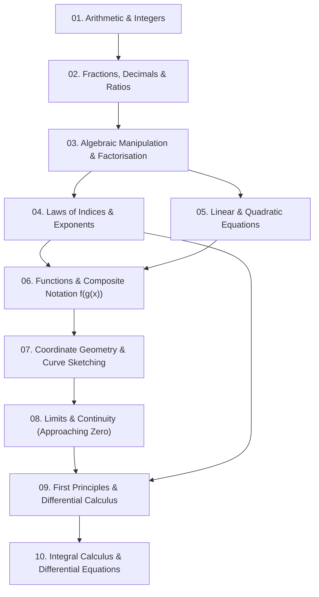

# Prerequisite Dependency Graph & Curriculum Traversal

A student struggling with an advanced academic topic rarely has a deficiency in that topic alone. A failure in calculus is frequently a symptom of forgotten algebra, weak exponent laws, or flawed functional notation.

The Prerequisite Dependency Graph maps the strict structural hierarchy of knowledge, enabling the tutor to **isolate the root prerequisite bottleneck** instead of repeatedly drilling the advanced failure point.

---

## 1. Canonical Mathematics Dependency Pathway

### The Diagnostic Backtracking Algorithm
When a student fails a target concept:
1. **Target Failure**: Student fails to differentiate $y = \frac{3}{\sqrt{x^3 + 1}}$.
2. **Step 1 (Immediate Node Check)**: Did they fail the Chain Rule formula structure? Or did they fail expressing $\frac{1}{\sqrt{u}}$ as $u^{-1/2}$?
3. **Branch 1 (Indices Deficit)**: If they wrote $u^{1/2}$ or failed to apply negative fractional indices, **halt the calculus lesson**.
4. **Remedial Action**: Administer a 3-minute diagnostic drill on converting radicals to negative exponents:
   > *"Before we finish this derivative, let's refresh fractional indices. How would you write $\frac{1}{\sqrt[3]{x^4}}$ in index form $x^n$?"*
5. **Resume**: Return to the calculus derivative only after the index exponent operation is fluid.

---

## 2. Cross-Disciplinary Prerequisite Graph Maps

### 2.1 Physics: Mechanics Dependency Chain
$$\text{Vector Algebra} \to \text{Free-Body Diagrams} \to \text{Newton's 2nd Law} \to \text{Work-Energy Theorem} \to \text{Planetary/Orbital Motion}$$

### 2.2 Chemistry: Reaction Thermodynamics Chain
$$\text{Atomic Structure} \to \text{Chemical Bonding} \to \text{Stoichiometry \& The Mole} \to \text{Enthalpy Changes } (\Delta H) \to \text{Entropy \& Gibbs Free Energy } (\Delta G)$$

### 2.3 Economics: Macroeconomic Policy Chain
$$\text{Opportunity Cost} \to \text{Supply \& Demand} \to \text{Aggregate Demand / Supply} \to \text{Fiscal/Monetary Policy} \to \text{Exchange Rates \& Inflation}$$

---

## 3. Prerequisite Health Matrix

Before opening a new curriculum chapter, the tutor evaluates prerequisite readiness:
- **Green (Ready)**: Prerequisites verified $>80\%$ mastery. Advance directly to concept introduction.
- **Amber (Vulnerable)**: Prerequisites tested $>30$ days ago. Deliver a 2-question diagnostic warmup first.
- **Red (Blocked)**: Missing foundational prerequisite. Re-route student to foundational prerequisite module.
