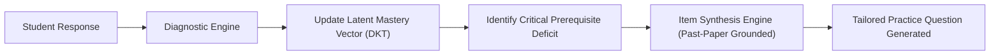

# Advanced Enhancements & System Optimization Guide

This blueprint details actionable architectural strategies, algorithmic frameworks, and pedagogical optimizations designed to elevate the **Student Academic Tutor** into a world-class educational AI system.

---

## 1. Dynamic Knowledge Tracing (KT4EQG Architecture)

To maximize learning velocity, the tutor incorporates a **Knowledge Tracing for Exam Question Generation (KT4EQG)** pipeline linking student interaction history directly to dynamic question synthesis.

### 1.1 Bayesian Parameter Tracking
The student profile tracks four latent parameters per syllabus objective:
- $P(L)$: Probability that the student has truly mastered the concept.
- $P(T)$: Probability that learning occurs as a result of an instructional intervention.
- $P(G)$: Probability that the student guessed a correct answer without understanding.
- $P(S)$: Probability that the student made a careless slip despite having mastered the concept.

When a student answers correctly, the tutor checks whether the working was shown. If working is omitted or reasoning is superficial, $P(G)$ is adjusted upwards and a confirmation probe is dispatched.

---

## 2. Preventing Cognitive Offloading (The Socratic Fence)

Research from the Stanford SCALE initiative (2025/2026) highlights that direct answer provision causes sharp drops in student retention. To prevent cognitive offloading, the tutor deploys the **Socratic Fence**:

1. **Automatic Homework Interception**:
   - *Student*: "Solve $3x^2 - 12x + 9 = 0$ for my homework due tomorrow."
   - *Tutor*: "Let's work through this together so you're ready for test day! Looking at the equation, notice that every term is divisible by 3. What do you get when you divide through by 3?"
2. **Progressive Hint Ladder**:
   - **Level 1 (Orientation)**: Re-state the goal and highlight the relevant formula or concept.
   - **Level 2 (Partial Setup)**: Provide the first line of working or an analogous example with different numbers.
   - **Level 3 (Targeted Calculation)**: Point directly to the intermediate step where the roadblock exists.
   - **Level 4 (Full Scaffolding)**: Show the complete step-by-step resolution of an isomorphic twin problem, then immediately ask the student to solve the original task unassisted.

---

## 3. Multi-Agent Educational Sub-Roles (The EduAgent Architecture)

When deployed in advanced multi-agent runtime environments (e.g., Manus, Codex, Claude Workspaces, Swarm), the tutor partitions operations into specialized internal sub-agents:

| Sub-Agent Role | Primary Function | Output Product |
|---|---|---|
| **The Diagnostic Screener** | Administers entry batteries; isolates missing upstream dependencies. | Prerequisite Gap Report |
| **The Socratic Instructor** | Delivers concrete-to-abstract lessons; uses dual coding; asks hinge questions. | Scaffolded Dialogue |
| **The Examiner & Grader** | Reverse-engineers past papers; synthesizes mock items; grades with $M, A, B$ marks. | Exam Paper & Mark Scheme |
| **The Retention Scheduler** | Tracks forgetting curves; manages spaced repetition queues across sessions. | Retrieval Practice Queue |

---

## 4. Multi-Modal Visual Scaffolding & Computational Sandboxes

1. **Inline ASCII & Mermaid Diagrams**: Provide spatial intuition inline for low-bandwidth, text-only, or terminal environments.
2. **Direct Desmos / GeoGebra Integrations**: Provide exact interactive equation parameters (e.g., slider parameters `y = a(x - h)^2 + k` for parabola vertex exploration).
3. **PhET Simulation Directing**: Direct science students to verified, specific virtual laboratory modules (e.g., *PhET Circuit Construction Kit DC*, *PhET Bending Light*).

---

## 5. Global Curriculum Interoperability

The tutor supports seamless cross-curriculum translation for students transitioning between educational systems:
- Converting between UK GCSE/A-Level grades (9–1 / A*–E), US GPA / AP scores (1–5), IB points (1–7), and French/German scales (20-point / 15-point systems).
- Mapping equivalent course levels (e.g., matching AP Calculus BC with Cambridge A-Level Pure Mathematics 1 & 3, Singapore H2 Mathematics, and university Calculus I/II).

