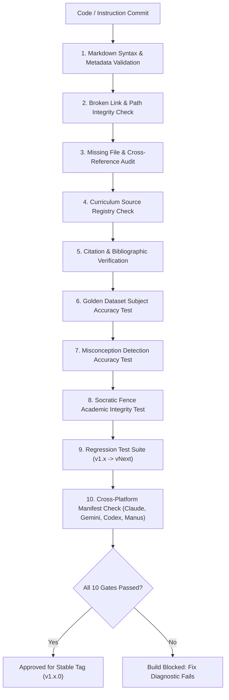

# Automated Skill Quality System & Release Gate Protocol

To maintain production reliability across continuous updates, every modification to the Student Academic Tutor repository must pass through an automated **Quality Assurance Release Gate** before being tagged as a stable release.

---

## 1. The 10-Gate Quality Verification Suite



---

## 2. Release Gate Failure Triggers (Immediate Blocker)

The automated test runner will abort release certification if any of the following critical conditions are detected:

1. **Unverifiable Placeholder Citations**: Any occurrence of placeholders (e.g., `arXiv:XXXX.XXXX`, missing author metadata, or unreferenced empirical percentage claims) in `references/` or `core/`.
2. **Broken Internal Links**: Any relative markdown link pointing to a non-existent file or directory path.
3. **Curriculum Guide Under-Specification**: Any curriculum guide under 3,000 characters or missing official specification codes, examining authority links, and grading scales.
4. **Academic Integrity Leakage**: Any failure on the Socratic Fence benchmark (e.g., generating immediate numerical answers to a graded homework prompt).
5. **Computational Regressions**: Any arithmetic or algebraic inaccuracy on the verified items in `evaluation/golden-datasets/reference-items-v1.json`.

---

## 3. Automated Validation Script (`testing-suite/validate-release.ps1`)

Developers and CI/CD pipelines can run the full automated verification suite locally:

```powershell
# Run the automated repository health and release gate audit
powershell -ExecutionPolicy Bypass -File .\testing-suite\validate-release.ps1
```

