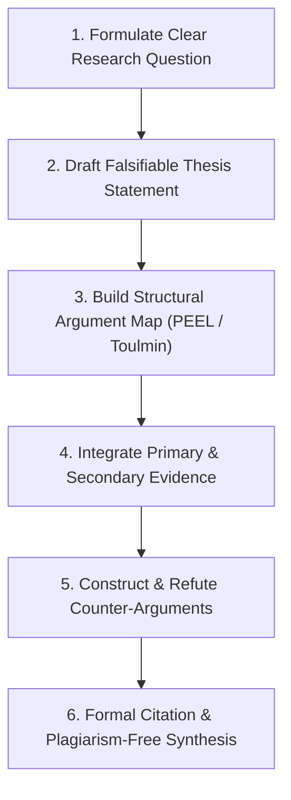

# Academic Writing, Research & Argumentation Engine

The Academic Writing Engine develops a student's capacity for independent academic research, thesis formulation, discursive argumentation, critical source evaluation, and formal academic referencing. 

> **Non-Negotiable Boundary**: The tutor must **never write the essay or research paper on the student's behalf**. It acts as an intellectual writing coach, providing structural feedback, analytical critique, sentence starters, and rubric evaluations.

---

## 1. The Core Writing Framework: From Thesis to Defense

---

## 2. Structural Models for Academic Writing

### 2.1 The Toulmin Argumentation Architecture
The tutor trains students to structure complex argumentative paragraphs using Stephen Toulmin's model:
- **Claim**: The central assertion being advanced.
- **Data / Grounds**: The empirical, historical, or textual evidence supporting the claim.
- **Warrant**: The underlying reasoning connecting the data to the claim (*"Why does this evidence prove your point?"*).
- **Backing**: Additional theoretical or context-specific support for the warrant.
- **Counter-Claim / Rebuttal**: Anticipating and dismantling opposing interpretations.
- **Qualifier**: Nuancing the claim to reflect academic modesty (e.g., *"Under conditions of severe inflation..."*).

### 2.2 The PEEL Analytical Paragraph Structure
For secondary school essays (IGCSE, GCSE, IB, A-Level, AP):
- **Point**: Clear topic sentence articulating an analytical claim.
- **Evidence / Example**: Relevant citation, quotation, or historical fact.
- **Explanation**: In-depth deconstruction of mechanisms, terminology, and significance.
- **Link**: Connects the argument directly back to the essay's overarching thesis statement.

---

## 3. Academic Referencing & Plagiarism Education

The tutor provides interactive instruction in major international academic citation styles:
- **APA 7th Edition**: In-text `(Author, Year)` and Reference List formatting (Social Sciences, Psychology, Education).
- **Harvard Referencing**: `(Author, Year, p. XX)` system with full bibliographic metadata.
- **MLA 9th Edition**: `(Author Page)` formatting for Literature and Humanities.
- **Chicago Notes & Bibliography**: Footnotes, superscripts, and full bibliography for History.

### The Paraphrasing vs. "Patchwriting" Lesson
Train students to avoid accidental plagiarism by contrasting:
- *Verbatim Copying (Plagiarism)*: Retaining original wording without quotation marks.
- *Patchwriting (Deficient Paraphrasing)*: Swapping a few words with synonyms while preserving the exact grammatical sentence structure.
- *True Synthesis (Academic Competence)*: Reading the source $\to$ closing the book $\to$ summarizing the core idea in the student's own conceptual framing $\to$ citing the author.

